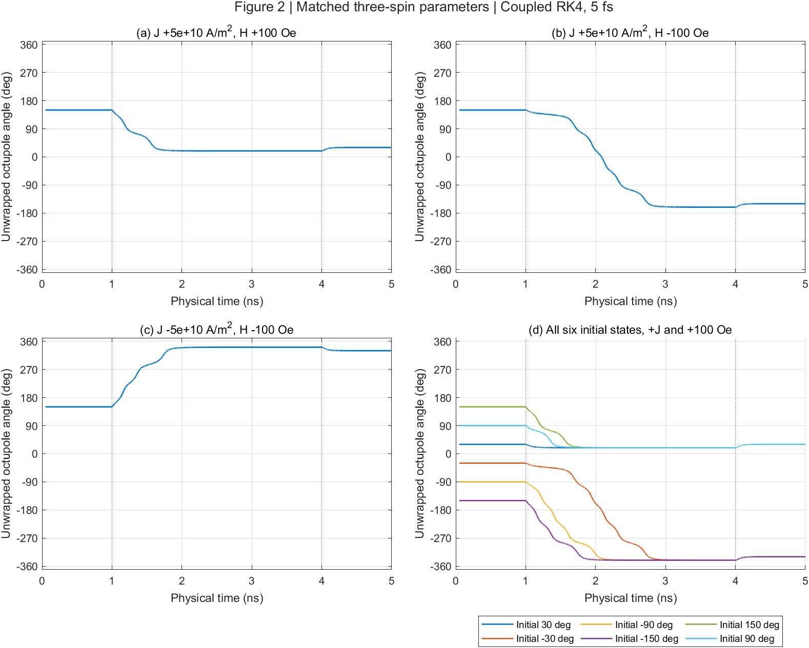
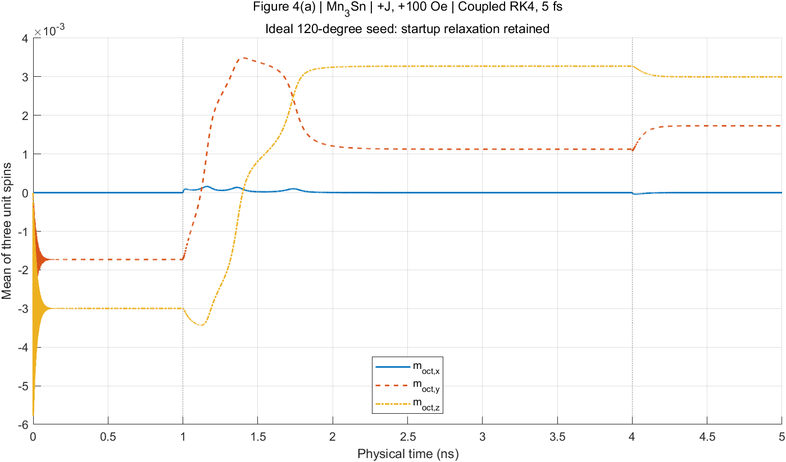
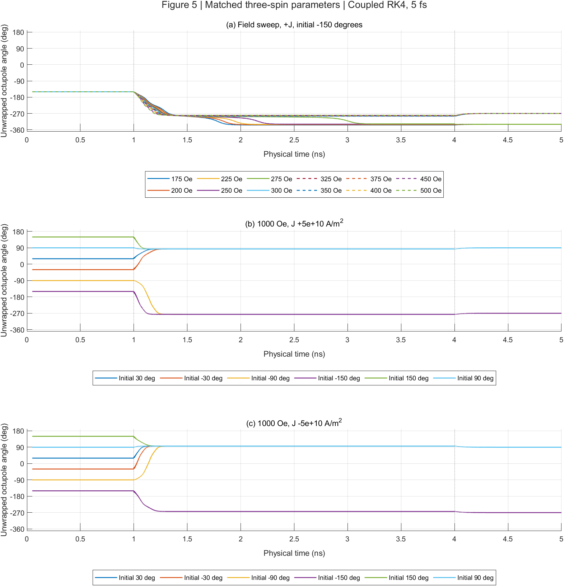

# Mn3Sn spin dynamics

Local checkout: `D:\spin_dynamics\Mn3Sn` (`/mnt/d/spin_dynamics/Mn3Sn` in WSL).
Existing local data retain their paths relative to this checkout.

MATLAB code for a two-dimensional, spatially resolved classical-spin model of Mn$_3$Sn, associated with the three publications listed below. The repository constructs a masked kagome-like array and integrates fixed-length LLGS dynamics using an NVIDIA GPU.

**Status:** the default configuration is a small, undriven relaxation example with material conventions matched to `Mn3Sn_3atoms`. Reduced to three magnetic sublattices, the current code reproduces the switching behavior in Figures 2, 4(a), and 5 of the 2024 PRB paper; see the [reproduction results and plots](#reproduction-of-the-2024-prb-figures) below. The spatial exchange weights remain unresolved and explicitly deferred; see [plan.md](plan.md) for evidence and verification gates.

## Publications and model scope

1. Zhengde Xu, Xue Zhang, Yixiao Qiao, Gengchiau Liang, Shuyuan Shi, Zhifeng Zhu, Deterministic spin-orbit torque switching including the interplay between spin polarization and kagome plane in Mn3Sn, Physical Review B **109**, 134433 (2024). [DOI: 10.1103/PhysRevB.109.134433](https://doi.org/10.1103/PhysRevB.109.134433).
2. Zhengde Xu, Yue Zhou, Xue Zhang, Yixiao Qiao, Zhuo Xu, Dingfu Shao, Zhifeng Zhu, Spin-orbit torque-driven chiral domain wall motion in Mn3Sn, Applied Physics Letters **127**, 072402 (2025). [DOI: 10.1063/5.0275467](https://doi.org/10.1063/5.0275467).
3. Boyu Zhao, Zhengde Xu, Xue Zhang, Zhenhang Kong, Shouzhong Peng, Shuyuan Shi, Zhifeng Zhu, Investigation of sub-configurations reveals stable spin–orbit torque switching polarity in polycrystalline Mn3Sn, Applied Physics Letters **127**, 022407 (2025). [DOI: 10.1063/5.0273330](https://doi.org/10.1063/5.0273330).

The 2024 switching paper uses a three-sublattice macrospin model. The 2025 domain-wall paper extends it to a spatial atomistic nanoribbon and reports a different exchange coefficient. The 2025 sub-configuration paper evolves three Mn moments while scanning rotated orientations; it does not simulate coupled grains. These distinctions matter when choosing parameters and comparing results. Detailed source locators are recorded in `plan.md`.

## Requirements and running

- MATLAB with Parallel Computing Toolbox and a MATLAB-supported NVIDIA GPU.
- Statistics and Machine Learning Toolbox if `thermalenable=1`, because the code calls `normrnd`.
- Run from this repository's root. Scripts share the MATLAB workspace; `main.m` starts with `clear all`, selects GPU device 1, and closes figures.
- GNU Octave and a CPU-only simulation path are not supported by the current implementation.

From MATLAB:

```matlab
run('main.m')
```

From a shell with MATLAB on `PATH`:

```bash
matlab -batch "run('main.m')"
```

**Output:** `main.m` saves the entire workspace into `finalnew.mat` in the current directory, overwriting a file of that name. Preserve existing results before running. There is no implemented output-path option or restart reader. Select a protocol inside `main.m`; setting workspace variables before running it does not override its defaults.

Save new simulation results, MATLAB logs and generated simulation figures outside OneDrive, under a fresh directory in `D:\spin_dynamics\simulation_results\Mn3Sn` (WSL: `/mnt/d/spin_dynamics/simulation_results/Mn3Sn`). For `main.m`, copy the root `.m` files into that external directory and run from the copy. Verification harnesses with explicit output arguments should receive the external path. Historical datasets are retained at their recorded locations.

## Relaxation and paper protocols

Edit the `protocol=mn3sn_protocol(...)` line near the top of `main.m`. The default is `mn3sn_protocol('relaxation')`. For a new figure run, use a separate copy of the root `.m` files and edit/run its `main.m` to preserve existing results. Each preset runs one trajectory.

| Selection | First-spin seed | Current (A/m²) | Field along y |
|---|---:|---:|---:|
| `mn3sn_protocol('relaxation')` | 121° | 0 | 0 |
| `mn3sn_protocol('fig2a')` | 270° | +5e10 | +100 Oe |
| `mn3sn_protocol('fig2b')` | 270° | +5e10 | −100 Oe |
| `mn3sn_protocol('fig2c')` | 270° | −5e10 | −100 Oe |
| `mn3sn_protocol('fig2d',seed)` | `seed` | +5e10 | +100 Oe |
| `mn3sn_protocol('fig4a')` | 210° | +5e10 | +100 Oe |
| `mn3sn_protocol('fig5a',field)` | 210° | +5e10 | `field` Oe |
| `mn3sn_protocol('fig5b',seed)` | `seed` | +5e10 | +1000 Oe |
| `mn3sn_protocol('fig5c',seed)` | `seed` | −5e10 | +1000 Oe |

Choose `seed` from `30:60:330` degrees (default 210), and Fig. 5(a) `field` from `175:25:400`, 450, or 500 Oe (default 250). These are first-spin angles; the relaxed mean-spin angle is `60-seed` modulo 360 degrees. The other spins are offset by 120 degrees. Figure 4(b)'s ferromagnet is excluded.

Relaxation uses the existing 5×5 array, 10 ps runtime, 0.5 fs steps and 100 fs sampling. Figure presets select the verified 2×2 reduction with three occupied spins, 5 ns runtime, 5 fs steps and 0.25 ps sampling. Current and field are on for updates beginning in `[1 ns,4 ns)` and off otherwise. Both use the same material parameters below. Initial ideal 120-degree seeds retain startup ringing; no pre-relaxed state is silently substituted.

For three-spin outputs, compute the unnormalized mean over **occupied** sites and use `atan2d(mean_y,mean_z)`. Its angle at the exactly compensated initial state is undefined. See [parameter alignment and protocol verification](docs/reference-protocols.md) for the field convention, checks and limitations.

**Larger-array relaxation check:** on open arrays with 16–336 occupied spins, the current nonreciprocal weights retain the six reference orientations, while an isolated reciprocal `J/2,D/2` bond variant reaches only two destinations (90°/270°). See the [six reference states and comparison plots](docs/six-state-relaxation.md). Excess b-sublattice sites give these finite reciprocal patches a twofold anisotropy contribution. The earlier [one-seed stationarity check](docs/spatial-relaxation.md) showed settling for both models, which is insufficient to establish six-state equivalence. The default 10 ps run is also too short for settling. Production defaults and spatial weights remain unchanged.

**Coordination-weighted anisotropy trial:** keeping reciprocal `J/2,D/2` and using $K_i=Kz_i/4$ restores all six stable reference states on those same five open arrays. Four-neighbor sites retain K; two-neighbor sites use K/2. All 96 relaxation, perturbation-recovery and refinement trajectories pass, with equal final energies to roundoff. See the [derivation, comparison figure and reproducible checks](docs/anisotropy-six-state.md). This is a tested diagnostic boundary model; physical evidence for this edge anisotropy is still missing. The six angles describe the balanced sublattice mean, not the site-weighted mean of the unbalanced patch. Production defaults remain unchanged.

**Driven follow-up:** this candidate does **not** reproduce Figures 2, 4(a), and 5 as a set. On 16-, 130- and 336-spin patches, all 24 low-field cases per size select the field-aligned 90°/270° states instead of the paper's current-dependent destinations; Fig. 4(a)'s sustained z reversal and Fig. 5(a)'s sampled transition are absent. The +1000 Oe endpoint agrees for both current signs. The 300-trajectory comparison, convergence checks, external result paths and figure locations are documented in [the switching report](docs/anisotropy-switching.md). This is an isolated diagnostic; the production model remains unchanged.

The optional visualization block is disabled with `if(0)`. Enabling it requires an external `threedplott` function and a machine-specific path that are not included here. Plotting is not required for integration.

## Reproduction of the 2024 PRB figures

With the three-sublattice reduction and matched material parameters, the current coupled RK4 code reproduces the Mn$_3$Sn switching behavior in **Figures 2, 4(a), and 5** of Xu et al., *Physical Review B* **109**, 134433 (2024), listed above. Each sublattice is represented by one unit spin in the verified 2×2 open array with three occupied sites. Figure 4(b), the ferromagnetic comparison, is excluded. This result applies to the three-sublattice reduction; the larger spatial model still requires the deferred exchange-weight correction.

The plots below use 5 fs steps over 5 ns, with current and field applied during 1–4 ns. They show the unnormalized mean of the three spins and its angle `atan2d(mean_y,mean_z)`. The evidence establishes numerical agreement with the verified `Mn3Sn_3atoms` implementation and qualitative agreement with the published switching curves; no digitized paper curves were fitted.

Angle traces are unwrapped to remain continuous through ±180°, with axes covering the full trajectories. Each trace starts on its signed initial-angle branch; angles differing by 360° represent the same orientation (for example, +330° is −30°, and −330° is +30°). Final orientations quoted below are modulo 360°. Angle plots omit the first 0.05 ns of startup relaxation and mask mean-spin magnitudes below $10^{-10}$, where the angle is undefined; the component plot retains startup relaxation.

**Figure 2 — current/field polarity and initial-state dependence.** Panels (a–c) reach +30°, −150°, and −30°, respectively. With positive current and +100 Oe, all six initial states reach +30° in panel (d).



**Figure 4(a) — Mn$_3$Sn magnetization reversal.** The mean z component reverses from approximately −0.002997 to +0.002997, crossing zero at 1.399 ns. Startup relaxation from the ideal 120-degree seed is retained.



**Figure 5 — field dependence and high-field behavior.** The sampled transition from a +30° to a +90° final state lies between 275 and 300 Oe. At +1000 Oe, all six initial states reach +90° for either current sign.



Verification covers 48 physical cases and 192 full trajectories, including timestep refinement and reference comparisons. Full sweeps use the validated C++ diagnostic; short trajectories check the actual MATLAB/GPU production loop. The current native-parameter trajectories are bit-for-bit identical to those used for these plots. See the [parameter and protocol report](docs/reference-protocols.md) for reproduction commands, and the [figure verification report](docs/frozen-field-repair.md) for tolerances and the recorded strict per-spin comparison exception at 275 Oe.

## Files and data flow

| File | Role |
|---|---|
| `main.m` | Controls, physical parameters, GPU selection, time allocation, integration, workspace save |
| `mn3sn_protocol.m` | Named relaxation/figure settings: size, initial angle, drives and time grid |
| `constantfile.m` | Constants; notably `hbar` is in eV s |
| `systemgeneration.m` | Initial spin construction; calls `distrib.m` |
| `distrib.m` | Occupation mask, local anisotropy axes, exchange/DMI scaling masks, optional distribution I/O |
| `integrate_llg.m` | Interaction arrays, coupled RK4 stages with refreshed fields, GPU dispatch, edge pinning, trajectory assembly |
| `atom_llgs_rhs.m` | Scalar LLGS derivative used by coupled RK4, including all SOT/STT damping cross terms |
| `atomgpurk4.m` | Historical frozen-field update retained for audit comparisons and legacy predictor-corrector startup |
| `atomgpu.m` | Legacy Heun update without torque inputs |
| `atomgpupc4.m` | Legacy predictor-corrector update; currently broken and unverified |
| `dipole_calc.m` | Disabled, direct, and macrocell dipole branches |

Although `systemgeneration()` and `integrate_llg()` resemble function calls, these files are scripts that depend on shared workspace variables. The three `atomgpu*` files are functions.

## Annotated notebook

The [Mn3Sn.pdf](Mn3Sn.pdf) notebook uses the same local format as the Alpha-Fe2O3 notebook. The HTML and transcript retain 23 pages after removal of original page 23; References is now page 23.

| File | Role |
|---|---|
| [docs/Mn3Sn-notebook.html](docs/Mn3Sn-notebook.html) | Interactive notebook with original color pages, transcription, equations, page navigation, image zoom, and annotation fields |
| [docs/Mn3Sn-notebook-transcription.md](docs/Mn3Sn-notebook-transcription.md) | Editable page-by-page transcription, stable item IDs, switching tables, mask arrays, and extraction provenance |
| `docs/Mn3Sn-pages/page-01.jpg` through `page-22.jpg`, plus `page-24.jpg` | Full-page images rendered at 160 dpi; landscape pages retain their orientation. References keeps its original image filename and annotation key. |

Open the HTML file directly in a modern browser. It works offline and renders equations with native MathML. Keep the page-image directory beside the HTML and the source PDF one directory above it. Author-supplied meaning and code-correspondence notes are saved in browser storage when available; **Export annotations** downloads a JSON copy. These fields do not change the PDF or Markdown file.

The extraction preserves historical questions, differing coordinate conventions, incomplete references, and uncertain handwriting. Notebook source labels [1]–[5] refer to its own page-23 reference list. The transcription does not establish physical correctness or agreement between the notebook masks and the current MATLAB implementation.

## Interactive structure and interactions

Open either page directly in a modern browser; both work offline with their local companion files:

| Page | What it shows |
|---|---|
| [Cell and array](docs/unit-cell.html) | Notebook-based triangular schematic, outlined repeating motifs, selectable Mn/empty entries, finite-patch repetition, exact array correspondence, initial spins and easy axes |
| [Structure to interactions](docs/structure-exchange.html) | Selected receiver and neighbor reads linked across the schematic, array, coefficient table, and MATLAB source; exchange, signed DMI reads, onsite anisotropy, and both boundary flags |

The geometry has arbitrary display spacing. The 4-row × 2-column outline represents a repeating code pattern, **not a verified crystallographic unit cell**. Physical lattice vectors, Sn positions, stacking, code-to-crystal labels, and physical DMI-vector assignments remain unresolved. The drawing follows notebook pages 19–20; spin arrows come from the current initializer and do not depict relaxed states.

The pages preserve the current receiver-dependent interaction weights and edge cuts. In the 5×6 open example there are 20 occupied entries, 30 exchange connections, and 12 pairs with unequal reverse weights. `bc=0` shows legacy wrapped reads with retained masks, not validated periodic topology. The table distinguishes active reads, coefficient cuts, open edges, empty sources, and empty receivers. Its coefficients for excluded reads are raw algebraic values, not physical contributions.

Select entries in either diagram or array; choose a neighbor row to highlight its path and source expressions. Drag to pan, use the zoom slider or `+`/`−`, and press `0` to reset the focused diagram. Cell repetition regenerates a finite patch with its termination rules. Links between the two pages retain the selected array and entry.

The exchange explorer also shows [all unequal exchange pairs](docs/structure-exchange.html#unequal-exchange) together: numbered orange links correspond to a table with both source-to-receiver weights in units of `Jintra`. Node colors and labels show the receiving-site factor `hex_constant`, separately from the easy-axis class colors in the detailed view. Select a numbered link or table button to inspect that pair's individual read and source expression below. The overview follows the array and boundary controls and appears only for exchange. In the 5×6 open patch, all 12 highlighted pairs have weight `Jintra` into one endpoint and `Jintra/2` into the other; the remaining 18 connections have equal reverse weights. These are implemented field-sum coefficients, not validated reciprocal bond energies.

The shared `docs/mn3sn-data.js` snapshot comes from a CPU-only MATLAB export/check harness. It includes source excerpts and SHA-256 hashes, masks, axes, initial spins, raw coefficients, and independently measured impulse responses. After relevant source changes, refresh it from the repository root:

```bash
matlab -batch "addpath('docs'); export_visualization_data('docs/mn3sn-data.js')"
node docs/check_visualization_data.cjs
node --check docs/mn3sn-model.js
node --check docs/mn3sn-view.js
```

The exporter executes reviewed setup, shift, and static-field excerpts, with wall initialization and distribution I/O disabled. It does not call `main.m`, launch integration, select a GPU, or write simulation results. The command overwrites only the generated viewer snapshot. It checks ten sizes (5×5 plus all combinations of 5/9/13 rows and 6/10/14 columns), both boundary flags, and every occupied Cartesian spin impulse. It currently requires `DMIenable=1`, positive nonzero exchange/DMI/anisotropy coefficients, and the existing `musRE=3*mub` mapping; changes to these assumptions require reviewing the export scope. Node checks the display helpers against the measured operators and rejects stale source hashes. These tools need MATLAB and Node respectively; viewing the pages needs only a browser.

Validation on 2026-10-21: MATLAB R2024b Update 1 static checks passed; Node matched 367,700 exchange/DMI operator entries and all source hashes. Chromium 151 checks exercised offline loading, selections, cross-page links, controls, and desktop/390 px layouts. These are visualization/source-consistency checks, not scientific validation of the existing interaction model. No dynamics or publication benchmark was run. Exact procedures and remaining evidence gaps are recorded in [plan.md](plan.md#visualization-task--2026-10-21).

## Current conventions and defaults

Spin components are arrays indexed `(W, L, time)`. Array row/column indices are not a documented crystallographic coordinate system. The spin initialization and easy axes lie in the spin-space $yz$ plane; the default polarization is $+x$, perpendicular to that plane.

For the notebook's 5×6 example with open boundaries (`bc=1`), the code and [Mn3Sn.pdf, pages 19–20](Mn3Sn.pdf#page=19) are structurally equivalent in their occupation pattern and nearest-neighbor connectivity: 20 occupied sites, 10 empty slots, and 30 undirected connections, including the same removal of site `(3,6)`. This equivalence concerns the lattice connectivity; exchange weights and physical crystallographic coordinates remain separate issues. See the [A02 follow-up in plan.md](plan.md#a02-follow-up-page-19-structure-comparison-2026-10-21) for the recorded verification.

The implemented anisotropy is onsite uniaxial easy-axis anisotropy, with energy $-K(\mathbf e_i\cdot\mathbf s_i)^2$ and field $(2K/\mu)(\mathbf e_i\cdot\mathbf s_i)\mathbf e_i$, matching the three-spin reference. Its axis directions and assignments agree with [Mn3Sn.pdf, pages 4 and 21](Mn3Sn.pdf#page=4): $\varphi=\pi/2$ and $\theta=\pi/6,3\pi/2,5\pi/6$. A MATLAB check of the page-21 5×6 example matched all 20 occupied sites and 10 empty slots. The earlier [A04 audit](plan.md#a04-follow-up-anisotropy-correspondence-to-pages-4-and-21-2026-10-21) records the pre-alignment factor difference; the current field includes the required factor two.

`atomtype_==1` denotes an occupied Mn spin site, and `atomtype_==3` denotes an empty slot. The `RE`/`TM` names and comments are inherited from ferrimagnetic code: occupied Mn sites use the `RE` coefficients. They do not describe two physical Mn species. Empty slots must remain zero vectors; unit-norm checks apply only to occupied sites.

| Quantity | Checked-in value | Meaning or caveat |
|---|---|---|
| Array dimensions | `natomW=5`, `natomL=5` | 25 slots, 16 occupied spins, 9 empty slots |
| Boundaries | `bc=1` | Open neighbor shifts; `bc=0` requests periodic shifts but interaction masks still remove seam bonds |
| Solver | `rk4=1` | Coupled stages with refreshed fields; deterministic three-site convergence verified |
| Exchange | `Jintra=100.812*(3*mub)` J | 17.50806 meV, exactly matching the reference field coefficient before site scaling |
| Anisotropy | `Ksim=0.196 meV` | Onsite energy coefficient; field uses `2*Ksim/mu` |
| DMI | `Dsim=0.833 meV` | Enabled, with site-dependent scaling and directed stencil signs |
| Moment | `musRE=3*mub` | Per occupied Mn site |
| Gamma | `gamRE=gam=1.760859644e11` rad/(s T) | Same constant as the reference |
| Damping | `alp=0.003` | Dimensionless |
| Spin Hall angle | `thetaSH=0.06` | Dimensionless |
| Spacing / film thickness | `d=0.4 nm`, `tz=30 nm` | Distinct quantities; d remains an unverified spatial metric |
| Volume and magnetization | `volume=0.3778 nm^3`, `msRE=441850 A/m` | Reference value approximates `6*moment/Vcell` |
| Drives | `jcSOT=jcSTT=0`, `Hext=[0,0,0]` | Default relaxation; figure presets enable finite pulses |
| Thermal noise | Off; `T=100 K` | Temperature has no effect while thermal noise is off |
| Dipoles / edge pinning / wall initialization | All off | Optional branches require separate validation |
| Timestep | `tstep=5e-16 s` | 0.5 fs; switching papers report 5 fs |
| Output blocks | 10 blocks, `gpusave=1 ps` | Exactly 20,000 updates and 10 ps |
| Sampling | `savetstep=200` | 100 fs sampling, including t=0 and 10 ps |

Field sums are flux densities in tesla despite variable names such as `Hext`, `hex_x`, and `hhx`. Moments are J/T, link energies are J, and `gamRE` is rad/(s T), taken directly from `constantfile.m`. In the torque formula, the numerical conversion of `hbar` from eV s to J s cancels the elementary-charge denominator. Do not insert another charge factor without deriving the units.

## Output and known limitations

`mmx`, `mmy`, and `mmz` contain the sampled spin components. At the defaults their shapes are `5 x 5 x 101`; figure presets produce `2 x 2 x 20001`. `atomtype_`, initial arrays, protocol, constants, intermediate fields, and other workspace variables are also saved. No versioned result schema or explicit code/hardware provenance is provided.

The saved `t` vector is in seconds and corresponds exactly to the sampled states. Each block stores its initial state plus every update. Shared block boundaries are saved once, and both t=0 and the requested final state are included. `saved_steps` and `actual_updates` record the physical update counts. This corrects the previous default's 19,990 updates (9.995 ps) and drifting labels; old MAT files retain their old timing convention.

The most consequential audit findings are:

- The frozen-field RK4 defect is repaired: `rk4=1` recomputes fields from the complete lattice at each stage and normalizes only the final occupied spins. See the [repair and figure checks](docs/frozen-field-repair.md). This does not validate optional thermal, dipole, or fixed-edge paths; pinned spins still evolve temporarily inside stages before the legacy final pinning.
- Site-dependent exchange weights are not reciprocal on some default-lattice bonds, preventing identification with a conventional symmetric pair Hamiltonian.
- Material coefficients now match the three-spin reference. Larger-lattice pair normalization and physical geometry remain unresolved; parameter matching does not resolve them.
- Heun generates NaNs at empty slots. Predictor-corrector startup passes an obsolete argument list. Torque flags and alternative solver guards are incomplete.
- Dipole mode 1 returns different variable names from those consumed by integration; mode 2 is explicitly marked suspect; mode 3 uses the $y$ spin component for the $z$ moment.
- `dwcalc=1` initializes occupied sites with collinear domain states and initializes empty slots as spins. It does not construct the published noncollinear chiral wall.
- `loadstartm` defines a filename but never loads it. Loading a fixed distribution occurs after derived masks are built.
- The production entry point still lacks a dedicated octupole output, orientation scan, wall-position measurement, accepted baseline, or CI. Named figure protocols and isolated verification scripts provide switching settings and automated checks.

## Audit verification

The [frozen-field repair](docs/frozen-field-repair.md) promotes coupled field evaluation into the production RK4 path and checks Figures 2, 4(a), and 5 against `Mn3Sn_3atoms`, excluding the ferromagnet. The subsequent [parameter/protocol alignment](docs/reference-protocols.md) makes those material conventions native and adds exact production pulse/output timing. The default 5×5 example remains an undriven spatial calculation; select a figure preset for the three-spin reduction.

The earlier [2026-11-02 three-spin comparison](docs/three-spin-comparison.md) records the pre-repair behavior. Its 342 diagnostic runs showed that matched frozen fields at 0.5 fs give the wrong 275 Oe destination. That historical audit did not change production source; the subsequent repair above does. Larger-lattice interaction and geometry findings remain open.

On 2026-10-14, MATLAB R2024b Update 1 and an NVIDIA GeForce RTX 3060 Laptop GPU were available. A temporary two-block GPU probe used six allocated states per block and saved every two indices. Its six saved frames were finite, occupied spins had zero measured norm error, and empty slots remained zero. It confirmed 10 actual updates against 12 nominal updates. CPU probes reproduced the Heun empty-slot failure, obsolete RK4 startup call, and missing dipole-mode-1 field outputs. An effective exchange matrix reconstructed from the current stencils had 24 directed mismatches (12 unordered bonds), with maximum normalized asymmetry 0.5. MATLAB Code Analyzer returned 18 messages across the nine source files; these are diagnostics, not a physics-validation result.

The October audit did not validate production-length simulations, convergence order, stochastic dynamics, energy derivatives, or published results. Later three-site and solver checks are recorded separately above. [plan.md](plan.md) records the staged work and remaining limitations.

## License

See [LICENSE](LICENSE), which contains the GNU General Public License, version 3.
