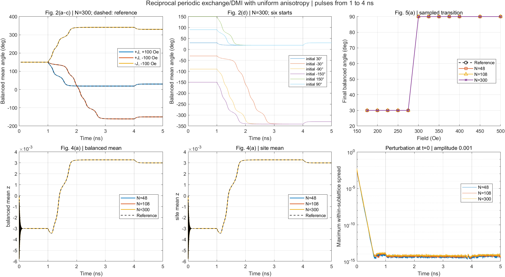
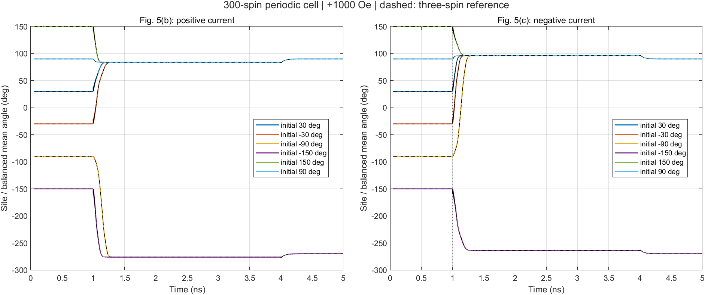

# Mn3Sn spin dynamics

Local checkout: `D:\Git_control\spin_dynamics\Mn3Sn` (`/mnt/d/Git_control/spin_dynamics/Mn3Sn` in WSL).
Existing local data retain their paths relative to this checkout.

MATLAB code for a two-dimensional, spatially resolved classical-spin model of Mn$_3$Sn, associated with the three publications listed below. The repository constructs a masked kagome-like array and integrates fixed-length LLGS dynamics using an NVIDIA GPU.

**Status:** production now uses reciprocal periodic boundaries (`bc=0`) on an 8×8 array with 48 independently evolving spins. The verified periodic model retains six stable orientations and reproduces the switching behavior of Figures 2, 4(a), and 5 of the 2024 PRB paper under the tested protocols. See the [periodic results and plots](#reproduction-of-the-2024-prb-figures) and [production verification](docs/periodic-production.md). The code graph is a mathematical model; physical crystallographic mapping and exchange-shell normalization remain unresolved.

## Publications and model scope

1. Zhengde Xu, Xue Zhang, Yixiao Qiao, Gengchiau Liang, Shuyuan Shi, Zhifeng Zhu, Deterministic spin-orbit torque switching including the interplay between spin polarization and kagome plane in Mn3Sn, Physical Review B **109**, 134433 (2024). [DOI: 10.1103/PhysRevB.109.134433](https://doi.org/10.1103/PhysRevB.109.134433).
2. Zhengde Xu, Yue Zhou, Xue Zhang, Yixiao Qiao, Zhuo Xu, Dingfu Shao, Zhifeng Zhu, Spin-orbit torque-driven chiral domain wall motion in Mn3Sn, Applied Physics Letters **127**, 072402 (2025). [DOI: 10.1063/5.0275467](https://doi.org/10.1063/5.0275467).
3. Boyu Zhao, Zhengde Xu, Xue Zhang, Zhenhang Kong, Shouzhong Peng, Shuyuan Shi, Zhifeng Zhu, Investigation of sub-configurations reveals stable spin–orbit torque switching polarity in polycrystalline Mn3Sn, Applied Physics Letters **127**, 022407 (2025). [DOI: 10.1063/5.0273330](https://doi.org/10.1063/5.0273330).

The 2024 switching paper uses a three-sublattice macrospin model. The 2025 domain-wall paper extends it to a spatial atomistic nanoribbon and reports a different exchange coefficient. The 2025 sub-configuration paper evolves three Mn moments while scanning rotated orientations; it does not simulate coupled grains. These distinctions matter when choosing parameters and comparing results. Detailed source locators are recorded in `plan.md`.

## Requirements and running

- MATLAB with Parallel Computing Toolbox and a MATLAB-supported NVIDIA GPU.
- Statistics and Machine Learning Toolbox if `thermalenable=1`, because the code calls `normrnd`.
- Run from this repository's root. Scripts share the MATLAB workspace; `main.m` starts with `clear all`, selects GPU device 1, and closes figures.
- GNU Octave and a CPU-only simulation path are not supported by the current implementation.

From MATLAB:

```matlab
run('main.m')
```

From a shell with MATLAB on `PATH`:

```bash
matlab -batch "run('main.m')"
```

**Output:** `main.m` saves the entire workspace into `finalnew.mat` in the current directory, overwriting a file of that name. Preserve existing results before running. There is no implemented output-path option or restart reader. Select a protocol inside `main.m`; setting workspace variables before running it does not override its defaults.

Save new simulation results, MATLAB logs and generated simulation figures outside OneDrive, under a fresh directory in `D:\Git_control\spin_dynamics\simulation_results\Mn3Sn` (WSL: `/mnt/d/Git_control/spin_dynamics/simulation_results/Mn3Sn`). For `main.m`, copy the root `.m` files into that external directory and run from the copy. Verification harnesses with explicit output arguments should receive the external path. Historical datasets are retained at their recorded locations.

## Relaxation and paper protocols

Edit the `protocol=mn3sn_protocol(...)` line near the top of `main.m`. The default is `mn3sn_protocol('relaxation')`. For a new figure run, use a separate copy of the root `.m` files and edit/run its `main.m` to preserve existing results. Each preset runs one trajectory.

| Selection | First-spin seed | Current (A/m²) | Field along y |
|---|---:|---:|---:|
| `mn3sn_protocol('relaxation')` | 121° | 0 | 0 |
| `mn3sn_protocol('fig2a')` | 270° | +5e10 | +100 Oe |
| `mn3sn_protocol('fig2b')` | 270° | +5e10 | −100 Oe |
| `mn3sn_protocol('fig2c')` | 270° | −5e10 | −100 Oe |
| `mn3sn_protocol('fig2d',seed)` | `seed` | +5e10 | +100 Oe |
| `mn3sn_protocol('fig4a')` | 210° | +5e10 | +100 Oe |
| `mn3sn_protocol('fig5a',field)` | 210° | +5e10 | `field` Oe |
| `mn3sn_protocol('fig5b',seed)` | `seed` | +5e10 | +1000 Oe |
| `mn3sn_protocol('fig5c',seed)` | `seed` | −5e10 | +1000 Oe |

Choose `seed` from `30:60:330` degrees (default 210), and Fig. 5(a) `field` from `175:25:400`, 450, or 500 Oe (default 250). These are first-spin angles; the relaxed mean-spin angle is `60-seed` modulo 360 degrees. The other spins are offset by 120 degrees. Figure 4(b)'s ferromagnet is excluded.

All presets use **8×8 slots, 48 occupied spins**, with periodic boundaries in both array directions. Relaxation retains its 10 ps runtime, 0.5 fs steps and 100 fs sampling; this short default is a smoke example, not enough to establish settling. Figure presets use 5 ns runtime, 5 fs steps and 0.25 ps sampling. Current and field are on for updates beginning in `[1 ns,4 ns)` and off otherwise. Initial ideal 120-degree seeds retain startup ringing.

For another periodic size, set `protocol.natomW` and `protocol.natomL` immediately after selecting the protocol in `main.m`. W must be a positive multiple of four; L must be even and at least four. Tested arrays are 8×8, 12×12 and 20×20 (48, 108 and 300 spins). Invalid dimensions are rejected. Each site has four neighbors with reciprocal exchange `Jintra/2`, antisymmetric directed DMI of magnitude `Dsim/2`, and uniform onsite `Ksim`. Set `bc=1` only to select the retained legacy open model, whose receiver-dependent weights differ from this periodic model.

Compute the unnormalized mean over **occupied** sites and its angle `atan2d(mean_y,mean_z)`. Equal a/b/c populations make this ordinary site mean equal to the balanced sublattice mean. The angle at an exactly compensated initial state is undefined.

**Six-state relaxation:** periodic arrays with 48, 108 and 300 spins recover all six 30°:60°:330° mean-spin orientations with equal energies to numerical precision. All 78 control, relaxation, perturbation, recovery, angular-offset and timestep-refinement trajectories passed. See the [relaxation report](docs/periodic-six-state.md) and [interactive periodic cell/bond view](docs/periodic-cell.html). Production now implements this same graph directly.

**Switching comparison:** all 48 PRB Figure 2, 4(a), and 5 reference cases pass at each periodic size. Ordinary site-mean trajectories agree with the numerical reference within 7.72e-12 per component. All 248 primary/control, refinement and perturbed-start runs pass; see the [comparison report](docs/periodic-prb2024.md). Perturbations were applied at t=0 and decay before the pulse, so this does not establish robustness to disturbances during switching.

Earlier open-boundary comparisons remain documented in the [six-state study](docs/six-state-relaxation.md), [coordination-weighted anisotropy trial](docs/anisotropy-switching.md), and [nonreciprocal switching study](docs/nonreciprocal-switching.md). They describe different boundary/weight choices and are not the production default.

The optional visualization block is disabled with `if(0)`. Enabling it requires an external `threedplott` function and a machine-specific path that are not included here. Plotting is not required for integration.

## Reproduction of the 2024 PRB figures

The periodic spatial model reproduces the tested switching behavior in **Figures 2, 4(a), and 5** of Xu et al., *Physical Review B* **109**, 134433 (2024). Every occupied spin evolves independently; uniform starts remain coherent because each site's summed exchange/DMI coupling to the other classes equals the verified three-spin reference. Figure 4(b)'s ferromagnetic comparison is excluded. Agreement with the numerical reference is quantitative; agreement with the published curves is qualitative, without digitizing or fitting them.

The figures below come from the verified **periodic-boundary** simulations. They use 5 fs steps over 5 ns, with current and field applied during 1–4 ns. Angle panels show the 300-spin cell; size comparisons include 48, 108 and 300 spins. Dashed curves show the three-spin numerical reference. The default production preset uses the 48-spin cell with the same switching outcomes.

Angles use `atan2d(mean_y,mean_z)` and are unwrapped continuously. Angles differing by 360° represent the same orientation. Angle traces omit t<0.05 ns and mask in-plane mean magnitudes below $10^{-10}$; component traces retain startup relaxation. No smoothing is applied.

**Figures 2, 4(a), and 5(a).** Current/field polarity selects the reference destinations from all six starts. The mean z component reverses from approximately −0.002997 to +0.002997, crossing zero at **1.399 ns**. The sampled field-dependent transition from +30° to +90° lies in **275 < H <= 300 Oe**. The bottom-right panel shows recovery from a small perturbation applied at t=0.



**Figures 5(b,c).** At +1000 Oe, all six initial states reach +90° for either current sign; −270° is the same orientation on an unwrapped branch.



The 248-run comparison and saved-data plotting procedure are in the [periodic PRB report](docs/periodic-prb2024.md). Production promotion is checked separately against those exact model operators, fresh MATLAB/GPU trajectories, pulse/chunk timing and retained open controls in the [production verification report](docs/periodic-production.md). Historical three-spin plots and checks remain in the [earlier solver report](docs/frozen-field-repair.md).

## Files and data flow

| File | Role |
|---|---|
| `main.m` | Controls, physical parameters, GPU selection, time allocation, integration, workspace save |
| `mn3sn_protocol.m` | Named relaxation/figure settings: size, initial angle, drives and time grid |
| `constantfile.m` | Constants; notably `hbar` is in eV s |
| `systemgeneration.m` | Initial spin construction; calls `distrib.m` |
| `distrib.m` | Occupation mask, local anisotropy axes, exchange/DMI scaling masks, optional distribution I/O |
| `integrate_llg.m` | Interaction arrays, coupled RK4 stages with refreshed fields, GPU dispatch, edge pinning, trajectory assembly |
| `atom_llgs_rhs.m` | Scalar LLGS derivative used by coupled RK4, including all SOT/STT damping cross terms |
| `atomgpurk4.m` | Historical frozen-field update retained for audit comparisons and legacy predictor-corrector startup |
| `atomgpu.m` | Legacy Heun update without torque inputs |
| `atomgpupc4.m` | Legacy predictor-corrector update; currently broken and unverified |
| `dipole_calc.m` | Disabled, direct, and macrocell dipole branches |

Although `systemgeneration()` and `integrate_llg()` resemble function calls, these files are scripts that depend on shared workspace variables. The three `atomgpu*` files are functions.

## Annotated notebook

The [Mn3Sn.pdf](Mn3Sn.pdf) notebook uses the same local format as the Alpha-Fe2O3 notebook. The HTML and transcript retain 23 pages after removal of original page 23; References is now page 23.

| File | Role |
|---|---|
| [docs/Mn3Sn-notebook.html](docs/Mn3Sn-notebook.html) | Interactive notebook with original color pages, transcription, equations, page navigation, image zoom, and annotation fields |
| [docs/Mn3Sn-notebook-transcription.md](docs/Mn3Sn-notebook-transcription.md) | Editable page-by-page transcription, stable item IDs, switching tables, mask arrays, and extraction provenance |
| `docs/Mn3Sn-pages/page-01.jpg` through `page-22.jpg`, plus `page-24.jpg` | Full-page images rendered at 160 dpi; landscape pages retain their orientation. References keeps its original image filename and annotation key. |

Open the HTML file directly in a modern browser. It works offline and renders equations with native MathML. Keep the page-image directory beside the HTML and the source PDF one directory above it. Author-supplied meaning and code-correspondence notes are saved in browser storage when available; **Export annotations** downloads a JSON copy. These fields do not change the PDF or Markdown file.

The extraction preserves historical questions, differing coordinate conventions, incomplete references, and uncertain handwriting. Notebook source labels [1]–[5] refer to its own page-23 reference list. The transcription does not establish physical correctness or agreement between the notebook masks and the current MATLAB implementation.

## Interactive structure and interactions

Open these pages directly in a modern browser; all assets are local:

| Page | What it shows |
|---|---|
| [Periodic cell and interactions](docs/periodic-cell.html) | Production periodic graph: complete repeats, equal class counts, selected neighbors, wrapped images, reciprocal exchange and directed DMI |
| [Open cell and array](docs/unit-cell.html) | Retained legacy open branch: notebook schematic, finite-patch termination, initial spins and easy axes |
| [Open structure to interactions](docs/structure-exchange.html) | Retained legacy open weights and coefficient cuts; selected reads and unequal reverse exchange pairs |

Display spacing is schematic. The 4-row × 2-column motif is a code repeat, not a verified crystallographic unit cell. Physical lattice vectors, Sn positions, stacking and shell assignments remain unresolved. The periodic viewer starts at the production default 8×8; select a spin or neighbor, switch exchange/DMI/onsite terms, change cell size, and pan/zoom/reset. Outlined markers represent periodic images of existing spins.

Periodic data come from current-source MATLAB impulse measurements checked against an independently enumerated wrapped stencil. The open snapshots are exported and checked only with `bc=1`; they no longer advertise the former incomplete periodic mode. The 5×6 open example retains 20 occupied entries, 30 exchange connections and twelve pairs with unequal reverse weights.

Refresh and verification commands are in [production verification](docs/periodic-production.md). The views illustrate the implemented graph and do not supply geometry to the solver.

## Current conventions and defaults

Spin components are arrays indexed `(W, L, time)`. Array row/column indices are not a documented crystallographic coordinate system. The spin initialization and easy axes lie in the spin-space $yz$ plane; the default polarization is $+x$, perpendicular to that plane.

For the notebook's 5×6 example with open boundaries (`bc=1`), the code and [Mn3Sn.pdf, pages 19–20](Mn3Sn.pdf#page=19) are structurally equivalent in their occupation pattern and nearest-neighbor connectivity: 20 occupied sites, 10 empty slots, and 30 undirected connections, including the same removal of site `(3,6)`. This equivalence concerns the lattice connectivity; exchange weights and physical crystallographic coordinates remain separate issues. See the [A02 follow-up in plan.md](plan.md#a02-follow-up-page-19-structure-comparison-2026-10-21) for the recorded verification.

The implemented anisotropy is onsite uniaxial easy-axis anisotropy, with energy $-K(\mathbf e_i\cdot\mathbf s_i)^2$ and field $(2K/\mu)(\mathbf e_i\cdot\mathbf s_i)\mathbf e_i$, matching the three-spin reference. Its axis directions and assignments agree with [Mn3Sn.pdf, pages 4 and 21](Mn3Sn.pdf#page=4): $\varphi=\pi/2$ and $\theta=\pi/6,3\pi/2,5\pi/6$. A MATLAB check of the page-21 5×6 example matched all 20 occupied sites and 10 empty slots. The earlier [A04 audit](plan.md#a04-follow-up-anisotropy-correspondence-to-pages-4-and-21-2026-10-21) records the pre-alignment factor difference; the current field includes the required factor two.

`atomtype_==1` denotes an occupied Mn spin site, and `atomtype_==3` denotes an empty slot. The `RE`/`TM` names and comments are inherited from ferrimagnetic code: occupied Mn sites use the `RE` coefficients. They do not describe two physical Mn species. Empty slots must remain zero vectors; unit-norm checks apply only to occupied sites.

| Quantity | Checked-in value | Meaning or caveat |
|---|---|---|
| Array dimensions | `natomW=8`, `natomL=8` | 64 slots, 48 occupied spins, 16 empty slots; all presets |
| Boundaries | `bc=0` | Complete periodic seams; `bc=1` retains the legacy open branch |
| Solver | `rk4=1` | Coupled stages with refreshed fields; deterministic three-site convergence verified |
| Exchange | `Jintra=100.812*(3*mub)` J | 17.50806 meV base coefficient; each periodic bond uses half |
| Anisotropy | `Ksim=0.196 meV` | Onsite energy coefficient; field uses `2*Ksim/mu` |
| DMI | `Dsim=0.833 meV` | Enabled; periodic bonds have magnitude Dsim/2 and antisymmetric directed signs |
| Moment | `musRE=3*mub` | Per occupied Mn site |
| Gamma | `gamRE=gam=1.760859644e11` rad/(s T) | Same constant as the reference |
| Damping | `alp=0.003` | Dimensionless |
| Spin Hall angle | `thetaSH=0.06` | Dimensionless |
| Spacing / film thickness | `d=0.4 nm`, `tz=30 nm` | Distinct quantities; d remains an unverified spatial metric |
| Volume and magnetization | `volume=0.3778 nm^3`, `msRE=441850 A/m` | Reference value approximates `6*moment/Vcell` |
| Drives | `jcSOT=jcSTT=0`, `Hext=[0,0,0]` | Default relaxation; figure presets enable finite pulses |
| Thermal noise | Off; `T=100 K` | Temperature has no effect while thermal noise is off |
| Dipoles / edge pinning / wall initialization | All off | Optional branches require separate validation |
| Timestep | `tstep=5e-16 s` | 0.5 fs; switching papers report 5 fs |
| Output blocks | 10 blocks, `gpusave=1 ps` | Exactly 20,000 updates and 10 ps |
| Sampling | `savetstep=200` | 100 fs sampling, including t=0 and 10 ps |

Field sums are flux densities in tesla despite variable names such as `Hext`, `hex_x`, and `hhx`. Moments are J/T, link energies are J, and `gamRE` is rad/(s T), taken directly from `constantfile.m`. In the torque formula, the numerical conversion of `hbar` from eV s to J s cancels the elementary-charge denominator. Do not insert another charge factor without deriving the units.

## Output and known limitations

`mmx`, `mmy`, and `mmz` contain the sampled spin components. At the defaults their shapes are `8 x 8 x 101`; figure presets produce `8 x 8 x 20001`. `atomtype_`, initial arrays, protocol, constants, intermediate fields, and other workspace variables are also saved. No versioned result schema or explicit code/hardware provenance is provided.

The saved `t` vector is in seconds and corresponds exactly to the sampled states. Each block stores its initial state plus every update. Shared block boundaries are saved once, and both t=0 and the requested final state are included. `saved_steps` and `actual_updates` record the physical update counts. This corrects the previous default's 19,990 updates (9.995 ps) and drifting labels; old MAT files retain their old timing convention.

The most consequential audit findings are:

- The frozen-field RK4 defect is repaired: `rk4=1` recomputes fields from the complete lattice at each stage and normalizes only the final occupied spins. See the [repair and figure checks](docs/frozen-field-repair.md). This does not validate optional thermal, dipole, or fixed-edge paths; pinned spins still evolve temporarily inside stages before the legacy final pinning.
- Periodic exchange is reciprocal and DMI antisymmetric. The retained legacy open branch still has nonreciprocal receiver weights.
- Material coefficients now match the three-spin reference. Larger-lattice pair normalization and physical geometry remain unresolved; parameter matching does not resolve them.
- Heun generates NaNs at empty slots. Predictor-corrector startup passes an obsolete argument list. Torque flags and alternative solver guards are incomplete.
- Dipole mode 1 returns different variable names from those consumed by integration; mode 2 is explicitly marked suspect; mode 3 uses the $y$ spin component for the $z$ moment.
- `dwcalc=1` initializes occupied sites with collinear domain states and initializes empty slots as spins. It does not construct the published noncollinear chiral wall.
- `loadstartm` defines a filename but never loads it. Loading a fixed distribution occurs after derived masks are built.
- The production entry point still lacks a dedicated octupole output, orientation scan, wall-position measurement, accepted baseline, or CI. Named figure protocols and isolated verification scripts provide switching settings and automated checks.

## Audit verification

The [frozen-field repair](docs/frozen-field-repair.md) promotes coupled field evaluation into the production RK4 path and checks Figures 2, 4(a), and 5 against `Mn3Sn_3atoms`, excluding the ferromagnet. The subsequent [parameter/protocol alignment](docs/reference-protocols.md) makes those material conventions native and adds exact production pulse/output timing. The default 8×8 periodic example remains an undriven spatial calculation; select a figure preset for periodic switching. The earlier three-spin open reduction remains a verification control.

The earlier [2026-11-02 three-spin comparison](docs/three-spin-comparison.md) records the pre-repair behavior. Its 342 diagnostic runs showed that matched frozen fields at 0.5 fs give the wrong 275 Oe destination. That historical audit did not change production source; the subsequent repair above does. Larger-lattice interaction and geometry findings remain open.

On 2026-10-14, MATLAB R2024b Update 1 and an NVIDIA GeForce RTX 3060 Laptop GPU were available. A temporary two-block GPU probe used six allocated states per block and saved every two indices. Its six saved frames were finite, occupied spins had zero measured norm error, and empty slots remained zero. It confirmed 10 actual updates against 12 nominal updates. CPU probes reproduced the Heun empty-slot failure, obsolete RK4 startup call, and missing dipole-mode-1 field outputs. An effective exchange matrix reconstructed from the then-current open stencils had 24 directed mismatches (12 unordered bonds), with maximum normalized asymmetry 0.5. MATLAB Code Analyzer returned 18 messages across the nine source files; these are diagnostics, not a physics-validation result.

The October audit did not validate production-length simulations, convergence order, stochastic dynamics, energy derivatives, or published results. Later three-site and solver checks are recorded separately above. [plan.md](plan.md) records the staged work and remaining limitations.

## License

See [LICENSE](LICENSE), which contains the GNU General Public License, version 3.
