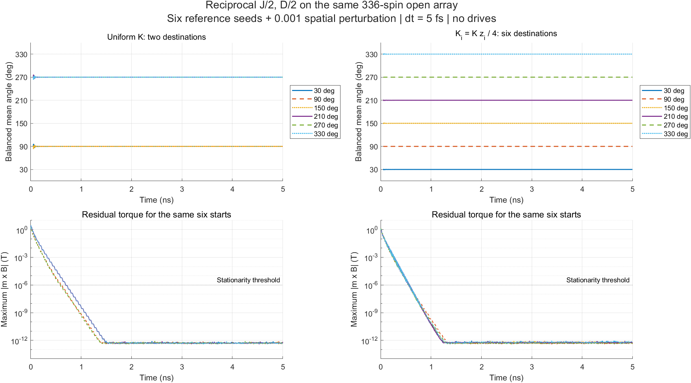
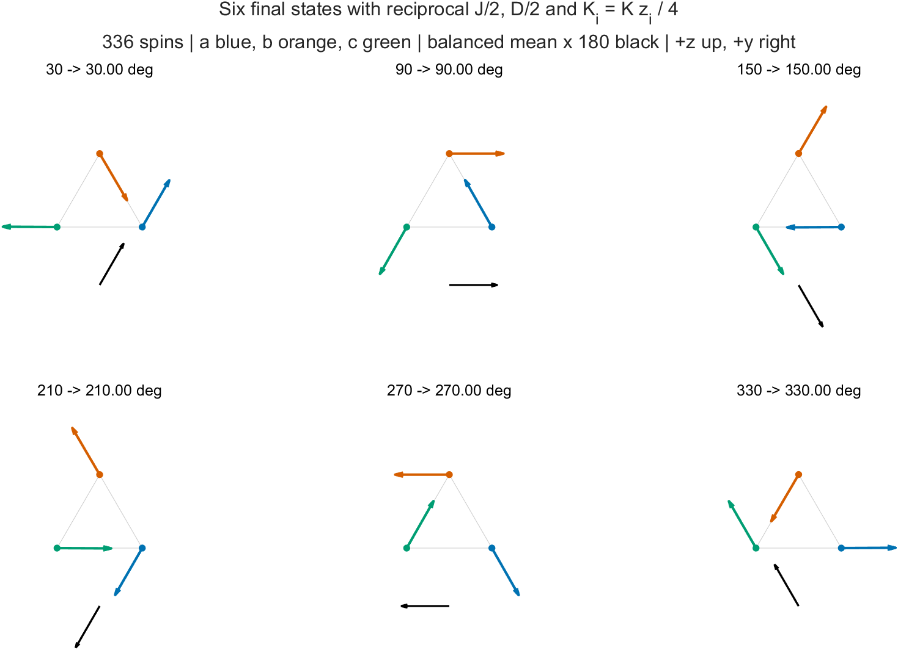

# Reciprocal six-state relaxation with coordination-weighted anisotropy

**The proposed correction passes the six-state test on all five open arrays, containing 16–336 spins.** With reciprocal $J/2,D/2$ bonds and $K_i=Kz_i/4$, each of the six starts relaxes to its corresponding reference state: 30°, 90°, 150°, 210°, 270°, or 330°. This includes perturbed starts and recovery after perturbing the relaxed states.

This is an isolated, user-approved boundary-model trial. Production MATLAB sources and defaults are unchanged. The correction is implemented in the diagnostic's `triangle` mode, with source/GPU verification through an array-valued `Ksim`. It is not yet a published or experimentally justified model of real Mn3Sn edge anisotropy.



The figure compares the previous uniform-$K$ reciprocal result with the new candidate on the same 336-spin graph. Both use six ideal reference seeds with deterministic noncoplanar perturbation amplitude $10^{-3}$. Lines use the balanced sublattice mean angle; the first 0.05 ns and undefined moments below $10^{-10}$ are omitted from angle panels only. Angles are unwrapped onto their initial branches. Torque panels retain the full run. Samples are 5 ps apart, without smoothing.



Arrows show actual relaxed sublattice averages, with the balanced mean amplified by 180; positions are schematic, +z is up and +y is right.

## Model and derivation

Retain the existing occupied-site graph, easy axes and directed DMI signs. With each bond counted once,

$$
E=\sum_{i<j}\left[\frac J2\mathbf m_i\cdot\mathbf m_j-\frac D2\sigma_{ij}\hat x\cdot(\mathbf m_i\times\mathbf m_j)\right]-\sum_i K_i(\mathbf e_i\cdot\mathbf m_i)^2,
\qquad K_i=\frac{Kz_i}{4}.
$$

Here $z_i$ counts actual occupied exchange neighbors, and $\sigma_{ji}=-\sigma_{ij}$ is the source stencil sign. Thus four-neighbor sites retain $K=0.196$ meV and two-neighbor sites use $K/2=0.098$ meV. Moments remain $\mu=3\mu_B$ at every occupied site. Exchange and DMI are reciprocal; no receiver-dependent moment or damping compensation is introduced.

The corresponding anisotropy field is

$$
\mathbf B_{{\rm ani},i}=\frac{2K_i}{\mu}(\mathbf e_i\cdot\mathbf m_i)\mathbf e_i,
\qquad \mathbf B_i=-\frac{1}{\mu}\frac{\partial E}{\partial\mathbf m_i}.
$$

Every bond in each checked graph belongs to exactly one triangle. Each triangle contains one a, b and c site with the same DMI chirality as the reference triangle; every site belongs to $z_i/2$ triangles. Therefore

$$
E=\frac12\sum_{\triangle} E_{\triangle}^{\rm reference}.
$$

Each triangle contributes $K/2$ at each vertex, and a site shared by $z_i/2$ triangles receives $Kz_i/4$. The same canting and six minima of the reference triangle are consequently compatible across the graph. This construction also makes the weighted sublattice populations $\sum_{i\in a,b,c}z_i/4$ equal, removing the population-induced twofold contribution found with uniform onsite $K$.

| Array | Occupied spins | Triangles | Sites with $K/2$ | Sites with $K$ | Weighted population per sublattice | Stable destinations |
|---|---:|---:|---:|---:|---:|---:|
| 5×5 | 16 | 8 | 8 | 8 | 4 | 6 |
| 5×6 | 20 | 10 | 10 | 10 | 5 | 6 |
| 9×10 | 63 | 36 | 18 | 45 | 18 | 6 |
| 13×14 | 130 | 78 | 26 | 104 | 39 | 6 |
| 21×22 | 336 | 210 | 42 | 294 | 105 | 6 |

This identity is verified for these source-derived open graphs. Applying the degree rule to a different graph does not establish a triangle decomposition automatically. An isolated three-site triangle has $J/2,D/2,K/2$, hence the same equilibria but twice the undriven dynamical timescale of the original full-strength triangle.

## Numerical evidence

The suite uses fixed-length deterministic LLGS with unchanged coupled RK4, $\alpha=0.003$, $\gamma=1.760859644\times10^{11}$ rad/(s T), native $J=100.812\mu$, $D=0.833$ meV, and zero current, external field, noise, dipoles and pinning. Spins are normalized only after each complete RK4 step. Runs use:

- **60 primary trajectories:** five sizes × six seeds × ideal/perturbed starts, 5 ns at 5 fs.
- **30 recovery trajectories:** each relaxed configuration perturbed by $10^{-3}$, then evolved for another 2 ns at 5 fs.
- **Six refinement trajectories:** all perturbed starts on the 336-spin graph, 2 ns at 2.5 fs, compared at common samples against the 5 fs runs.

| Check | Measured maximum or outcome |
|---|---|
| Distinct full-spin destinations | Six per size; nearest pair differs by more than 0.9948 in a spin component |
| Final angle error | Below $1.8\times10^{-10}$ degree |
| Final spin difference from lifted reference triangle | $2.15\times10^{-12}$ per component |
| Spatial variation within a sublattice | $2.90\times10^{-14}$ per component |
| Final energy spread across states and seed perturbations, at fixed size | $1.78\times10^{-15}$ meV/spin |
| Final maximum transverse field | $8.11\times10^{-13}$ T |
| Recovery difference from the unperturbed relaxed state | $3.49\times10^{-12}$ per component |
| 5 fs versus 2.5 fs sampled trajectory difference | $2.31\times10^{-7}$ per component; gate $10^{-5}$ |
| Occupied-spin norm error after normalization | $2.23\times10^{-16}$ |
| Largest norm error before normalization | $2.04\times10^{-12}$ |
| Largest sampled energy increase | $8.25\times10^{-13}$ T in $E/(N\mu)$, consistent with accumulation roundoff |

Independent finite-difference energy derivatives agree with candidate fields within $4.77\times10^{-9}$ T. Actual MATLAB source expressions with the candidate coefficients agree with independently assembled random-state fields within $2.85\times10^{-14}$ T. Twelve 20-step MATLAB/GPU replays agree with the compiled diagnostic within $3.07\times10^{-16}$ per component; finite spins, exact-zero vacancies, norms, update counts and timestamps pass. Both previous diagnostic modes reproduce the old executable's short spin and scalar outputs byte-for-byte over six sizes.

Long trajectories use the source-checked compiled diagnostic, not full-length production GPU runs. The compiled diagnostic stores only occupied sites; exact vacancies are checked in the MATLAB/GPU fixtures. All 11 root MATLAB source hashes still match the prior source-derived operator export.

## Local stability beyond stationarity

For $F=E/\mu$, let $Q$ be its Cartesian Hessian, $P_i$ an orthonormal spin-tangent basis, and $\mathbf B_i=-\nabla_iF$. The constrained Hessian at a stationary state is

$$
H_{ij}=P_i^\mathsf TQ_{ij}P_j+\delta_{ij}(\mathbf m_i\cdot\mathbf B_i)I_2.
$$

All six half-strength reference triangles have strictly positive eigenvalues, approximately

$$
\{0.000132953,\ 4.69346,\ 4.74669,\ 81.6520,\ 82.0450,\ 155.938\}\ \mathrm T.
$$

The smallest curvature is $2.3090\times10^{-5}$ meV/rad². Each graph Hessian is a sum of these embedded positive triangle Hessians, and every site belongs to a triangle. This establishes strict local stability against spatial perturbations at the six lifted states. It does not establish global uniqueness, exclude other metastable textures, or prove recovery from arbitrarily large perturbations. Independent read-only verification reproduced the graph decomposition and Hessian result.

## Scope and observables

The six labels refer to the balanced mean $\mathbf m_{\rm bal}=(\overline{\mathbf m}_a+\overline{\mathbf m}_b+\overline{\mathbf m}_c)/3$. The physical site-weighted mean still reflects the excess b sites. On the 336-spin patch, its corresponding angles are approximately 139.31°, 90°, 40.69°, 319.31°, 270°, and 220.69°. Both are saved; the correction does not make the populations equal.

**REFERENCE MISSING:** physical evidence for reducing Mn3Sn edge anisotropy according to coordination. The correction is a consistent mathematical boundary model selected by the user. Physical crystallographic mapping, periodic seams, thermal behavior, dipoles and domain-wall propagation remain unverified. Existing production viewers continue to describe unchanged production coefficients.

**Driven follow-up (2026-11-03):** the [switching comparison](anisotropy-switching.md) tests the paper protocols on 16-, 130- and 336-spin patches. The candidate fails the low-field destination map, sustained z reversal and sampled field transition, despite passing numerical refinement and retaining the undriven six states. Only the high-field final-angle behavior agrees.

The equations conventions were checked against the read-only `presentations/equations` repository: `spintronic_methods.tex`, `sections/hamiltonian.tex` (`eq:atomistic-effective-field`), `sections/llg_equation.tex` (`eq:ll-with-flt`) and `sections/atomistic_boundaries.tex`. ASTRO AGENTS/README supplied workflow context only. Parameter and six-state reference evidence comes from the prior reviewed-paper/code comparison recorded in [plan.md](../plan.md), associated with Zhengde Xu, Xue Zhang, Yixiao Qiao, Gengchiau Liang, Shuyuan Shi, Zhifeng Zhu, *Deterministic spin-orbit torque switching including the interplay between spin polarization and kagome plane in Mn3Sn*, Physical Review B **109**, 134433 (2024), DOI: 10.1103/PhysRevB.109.134433. No new publication, paper-knowledge record or presentation record was ingested or used to justify the new boundary law.

## Reproduction and artifacts

Local raw results: `.sisyphus/anisotropy-trial-20261102-01/`. They include `candidate-gates.json`, `trial-checks.json`, `stability.json`, `six-state-summary.json`, all commands, source hashes, per-run CSV/binary states and MATLAB logs. Environment: MATLAB R2024b Update 1, NVIDIA GeForce RTX 3060 Laptop GPU; standard-library Python orchestration and GNU C++ compilation. No dependencies were installed.

The source matrices and reference states are the preserved earlier datasets. To recreate them, follow [the source replay report](spatial-relaxation.md) and [the six-state baseline report](six-state-relaxation.md). Then use a new output directory:

```bash
mkdir .sisyphus/anisotropy-trial-new
matlab -batch "addpath('verification/spatial_relaxation'); prepare_anisotropy('.sisyphus/spatial-relaxation-20261102-01','.sisyphus/anisotropy-trial-new')"
python3 verification/spatial_relaxation/anisotropy_trial.py .sisyphus/spatial-relaxation-20261102-01 .sisyphus/six-state-20261102-01 .sisyphus/anisotropy-trial-new check
python3 verification/spatial_relaxation/anisotropy_trial.py .sisyphus/spatial-relaxation-20261102-01 .sisyphus/six-state-20261102-01 .sisyphus/anisotropy-trial-new run
python3 verification/spatial_relaxation/anisotropy_trial.py .sisyphus/spatial-relaxation-20261102-01 .sisyphus/six-state-20261102-01 .sisyphus/anisotropy-trial-new analyze
matlab -batch "addpath('verification/spatial_relaxation'); check_anisotropy_stability('.sisyphus/spatial-relaxation-20261102-01','.sisyphus/six-state-20261102-01','.sisyphus/anisotropy-trial-new'); plot_anisotropy('.sisyphus/six-state-20261102-01','.sisyphus/anisotropy-trial-new','docs')"
```

The last command refreshes this report's two PNGs. `check` and `run` reject an already completed phase, protecting prior diagnostic data. The production source hashes associated with the matrix export are checked against the current root MATLAB files before each Python phase. The MATLAB harness evaluates source scripts with candidate coefficients without invoking `main.m` or saving `finalnew.mat`/`atomtypee.mat`.

All MATLAB preparation, Hessian and final plotting processes exited successfully. Both final PNGs were opened and visually inspected; plotting assertions check the saved sample counts, angle transformations and series counts. The previous investigation's MATLAB shutdown error did not recur. Changed and new text passed whitespace checks, Python syntax checks passed, and `git diff --check` passed. No production source, historical data, commit or push was changed by this trial.
