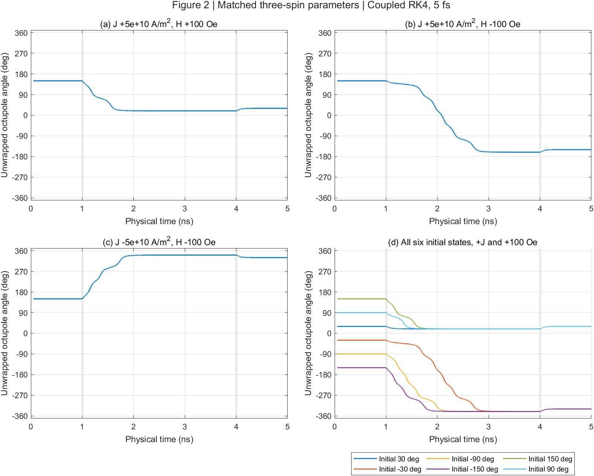
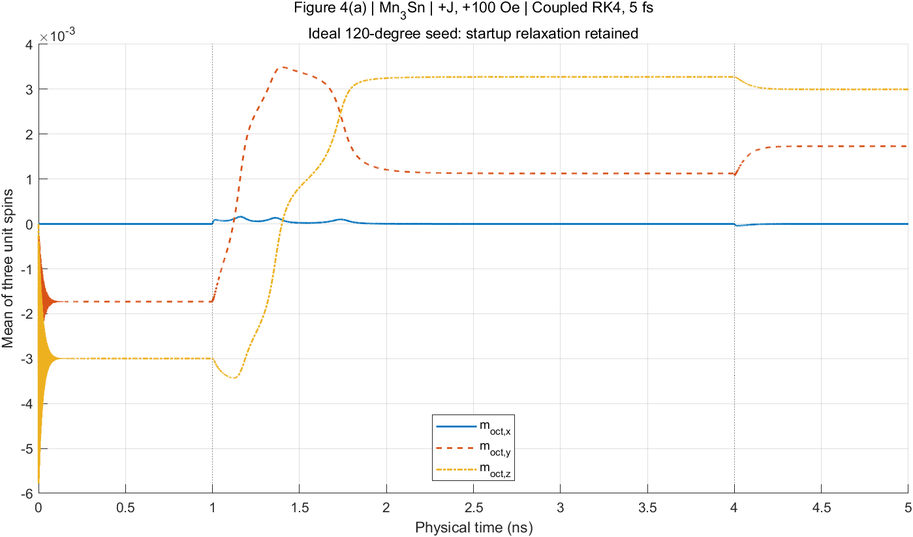
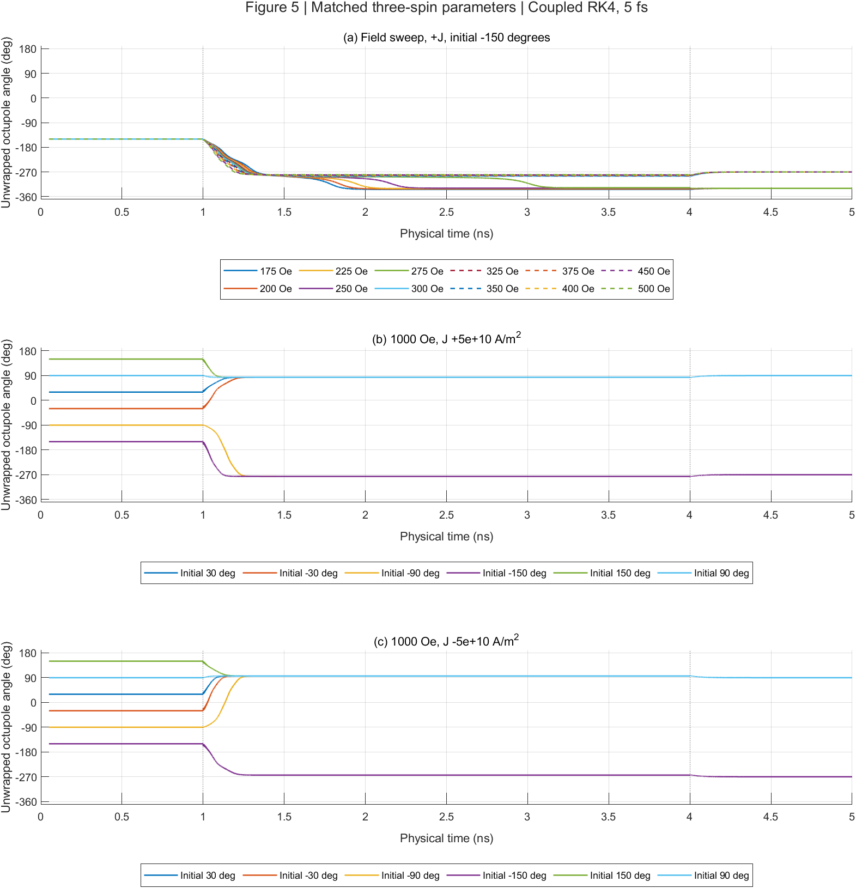

# Coupled RK4 repair and Figures 2, 4(a), 5

This report records the repair before parameter alignment. The subsequent
[parameter and protocol update](reference-protocols.md) makes the reference
material conventions native and corrects production pulse/output timing.
Descriptions below of differing defaults and the legacy clock are historical.
Current verification commands exercise the aligned parameters; the original
run directory contains the archived harness for the historical comparison.

The production `rk4=1` path now evaluates exchange, anisotropy, and DMI from
the **complete lattice state at every RK4 stage**. Previously the scalar
`atomgpurk4` update held the field fixed while changing each local spin.
That integrates a different local problem and can select the wrong final
state even at a small timestep; the [earlier comparison](three-spin-comparison.md)
records the 275 Oe failure at 0.5 fs.

`integrate_llg.m` now owns the four stages. `atom_llgs_rhs.m` contains the
unchanged first-stage derivative algebra, including all damping-dependent
SOT and STT cross terms. Stage states are unnormalized; only the final
weighted result is normalized, excluding empty sites. The old scalar
kernel remains available for historical comparisons and legacy startup.
No interaction coefficients, default parameters, torque signs, topology,
or drive timing were changed. Noise still uses one draw per outer step.

## Scope of the figure comparison

The target is the corrected `Mn3Sn_3atoms` implementation of Zhengde Xu,
Xue Zhang, Yixiao Qiao, Gengchiau Liang, Shuyuan Shi, and Zhifeng Zhu,
“Deterministic spin-orbit torque switching including the interplay between
spin polarization and kagome plane in Mn3Sn,” Physical Review B **109**,
134433 (2024), [DOI](https://doi.org/10.1103/PhysRevB.109.134433).
Model and protocol locators are Sec. II, Fig. 2/Table I, and Figs. 4–5 on
printed page 134433-5. The existing reviewed-paper evidence and reference
settings/report are identified in [plan.md](../plan.md).

The spatial model is Class 4 fixed-length LLGS. For this comparison, its
2×2 open array contains exactly three occupied spins plus one vacancy.
Reference spins `(a,b,c)` map to `((2,2),(1,1),(2,1))`. This is the established
three-vector Class 5 reduction, not a claim that a finite 5×5 lattice has
the same dynamics. The reduction has reciprocal exchange and cyclic,
antisymmetric DMI; the larger array's nonreciprocity remains unresolved.

The benchmark explicitly matches reference coefficients:

| Quantity | Value / convention |
|---|---|
| Moment | `3*mub` J/T |
| Exchange field coefficient | 100.812 T |
| Anisotropy | 0.196 meV; field coefficient `2*K/mu` |
| DMI | 0.833 meV; field coefficient `D/mu` |
| Gamma | 1.760859644e11 rad/(s T) |
| Damping / spin Hall angle | 0.003 / 0.06 |
| Magnetization / thickness | 441850 A/m / 30 nm |
| Polarization | +x, normal to the yz spin plane |
| Current | signed 5e10 A/m² |
| Pulses | Field and current on during 1–4 ns; total 5 ns |
| Numerical protocol | 5, 2.5, 1.25 fs; physical samples every 0.25 ps |

Native defaults differ, especially anisotropy (half the reference field)
and SOT (approximately 450 times the reference amplitude at equal current).
Fixing RK4 alone does not turn `main.m` into a figure reproduction driver.
No ferromagnetic model or Figure 4(b) trajectory is included.

The plotted observable is the unnormalized average of the three unit spins,
with signed angle `atan2d(mean_y,mean_z)`. The ideal 120-degree seed has zero
mean and hence undefined angle. Angle plots omit the first 0.05 ns, mask
means below 1e-10 and unwrap each remaining continuous segment through ±180°.
All finite angle samples fit within common limits across each figure's panels.
Initial signed branches are retained; final orientations are quoted modulo
360° (+330° equals −30°, and −330° equals +30°). Component plots retain startup
relaxation. This is numerical agreement with reference code and qualitative
agreement with the publication; no digitized published curves are available.

## Measured results — 2026-11-02

All 48 physical cases retain the expected destinations at all three matched
coupled timesteps. Figure 4(b) is excluded.

| Figure / protocol | Measured final result |
|---|---|
| Fig. 2: +J, +100 Oe, all six seeds | +30° |
| Fig. 2: +J, −100 Oe, all six seeds | −150° |
| Fig. 2: −J, −100 Oe, all six seeds | −30° |
| Fig. 2/Table I: −J, +100 Oe, all six seeds | +150° |
| Fig. 4(a): seed 210°, +J, +100 Oe | Mean z reverses from −0.002997322420 to +0.002997322433 |
| Fig. 5(a): +J, 175/200/225/250/275 Oe | +30° |
| Fig. 5(a): +J, 300/325/350/375/400/450/500 Oe | +90° |
| Fig. 5(b,c): +1000 Oe, both current signs, all six seeds | +90° |

The largest final-angle error is 6.63e-7 degree. Fig. 4(a)'s mean-z crossing
is **1.399001533608 ns**, with less than 4.3e-14 ns variation under refinement
for the sampled linear-interpolation estimate. The sampled Fig. 5 transition
bracket is **275 < H ≤ 300 Oe**; no finer critical field is inferred.

| Numerical check | Measured result |
|---|---:|
| Static reference-field discrepancy | 2.84e-14 T |
| Scaled energy-gradient residual | 2.23e-11 |
| All-torque implicit Gilbert residual | 3.20e-16 |
| Production-loop coupled convergence orders | 3.8016, 3.9136 |
| Startup production GPU/replay discrepancy | ≤4.43e-14 per spin component |
| Driven production GPU/replay discrepancy, eight cases | ≤7.38e-14 per spin component |
| Full-figure mean discrepancy, 5 vs 2.5 fs | 2.13797e-9 |
| Full-figure mean discrepancy, 2.5 vs 1.25 fs | 1.33636e-10 |
| Equal-dt spatial/reference mean discrepancy | ≤7.77e-12 |
| Maximum full-figure norm error after normalization, every update | 2.22e-16 |
| Maximum full-figure raw norm error before normalization | 2.98e-13 |

The short noncoplanar convergence fixture is more demanding than the near-120°
figure seeds: its preprojection error falls from 2.12e-6 at 10 fs to 1.81e-11
at 1.25 fs. This makes normalization an observed diagnostic rather than the
sole evidence of integrator accuracy. Vacancies remain exactly zero in all
production-loop tests.

The additional strict equal-dt per-spin tolerance of 1e-9 is **not met** at
275 Oe (2.93e-9); its small mean-observable discrepancy and passing convergence
are reported separately below. No parameter tuning was used to change this.

Plots from the saved matched-parameter 5 fs trajectories:







Fresh raw evidence is in `.sisyphus/frozen-field-20261102-01/`; the gate JSON,
`figures-analysis.json`, `figures-summary.csv`, source snapshots and
preservation manifest record the numerical results and provenance.
The preservation check passed for 29 source/result paths. All three exported
PNGs were visually inspected. `git diff --check` and whitespace checks for
new text files passed. MATLAB Code Analyzer reports no messages for the new
RHS or plotting function; its one production-script message concerns the
existing disabled debug block. Harness warnings flag unused arguments and
assignments in the wrapper that supplies variables to the evaluated script.

## Verification method

Environment: MATLAB R2024b Update 1 and NVIDIA GeForce RTX 3060 Laptop GPU;
existing GCC 11.4.0 and Python 3.10.12 standard library. No installations.

Static checks execute the actual source stencils on Cartesian impulses and
compare each term with the reference field and independent energy gradients.
The unchanged spatial-viewer exporter checks ten sizes and both boundary
flags, then Node compares 367,700 operator entries and source hashes. This
certifies preserved source/display correspondence, not physical periodicity.

`check_coupled_rk4` executes the **actual changed production loop** in a local
function workspace, using safe test sizes and initialization; it never calls
`main.m` or saves production results. For CPU convergence checks only,
GPU transfers become identity conversions and scalar arguments are explicitly
expanded for CPU `arrayfun`. GPU checks use the production statements without
those substitutions. A diagnostic observes the final raw norm before
normalization without modifying the state. The tests cover:

- All four SOT/STT amplitudes and the implicit Gilbert residual on unit spins.
- A noncoplanar coupled trajectory at 10/5/2.5/1.25 fs over 0.5 ps, requiring
  observed order between 3.7 and 4.3.
- GPU/CPU agreement, finite spins, occupied norm error below 1e-12, and exact
  zero vacancies; short 5×5 runs for both legacy boundary flags.
- Startup and driven production-GPU replays, requiring spin-component
  discrepancy below 1e-10 against the compiled diagnostic.

Full 5 ns sweeps use the existing C++ diagnostic **after** the initial
production gates pass. There are 48 physical cases: 24 low-field
seed/current/field-sign combinations and 24 Fig. 5 cases. Each is integrated
with matched coupled fields at three timesteps and with the reference
operation ordering at 5 fs, for 192 full trajectories. The independent
reference MATLAB loop is also checked in short replays. Full-length runs are
not production MATLAB/GPU runs.

Acceptance requires aligned physical times including exactly 5 ns, correct
update counts, finite states, norm error below 1e-12, mean-component changes
below 1e-5 under halving, final angles within 0.1 degree of the expected
destinations, and Fig. 4(a) crossing shifts below 1 ps. Reference and spatial
compiled trajectories must agree within 1e-10 in a mean component at equal dt.
An auxiliary 1e-9 per-spin check is recorded separately: the 275 Oe case
misses it, with 2.93e-9 maximum spin-component difference but only 7.77e-12
in the mean. The two compiled modes differ only in algebraic evaluation
order, so this difference comes from floating-point arithmetic. The original
planned mean-observable acceptance is unchanged; the stricter per-spin
exception remains visible in `strict_spin_match_pass` and is not called a pass.
These are numerical tolerances, not experimental error bars.

## Reproduce

From the repository root, choose a **fresh** directory under `.sisyphus`:

```bash
python3 verification/three_spin.py prepare .sisyphus/frozen-field-new
```

In MATLAB, from the repository root:

```matlab
addpath('verification');
out = fullfile(pwd,'.sisyphus','frozen-field-new');
check_three_spin(out);
```

Then Bash:

```bash
python3 verification/three_spin.py probes .sisyphus/frozen-field-new
```

MATLAB:

```matlab
check_three_spin_dynamics(out);
check_coupled_rk4(out);
```

Bash, after the MATLAB gates pass:

```bash
python3 verification/coupled_figures.py sweep .sisyphus/frozen-field-new
python3 verification/coupled_figures.py analyze .sisyphus/frozen-field-new
python3 verification/coupled_figures.py replays .sisyphus/frozen-field-new
```

Finish in MATLAB:

```matlab
check_coupled_rk4(out,'driven');
plot_coupled_figures(out);
```

To regenerate only the figures from the existing saved trajectories, without
rerunning dynamics or replacing historical plots, run from the repository root:

```matlab
addpath('verification');
out=fullfile('.sisyphus','frozen-field-20261102-01');
plotout=fullfile('.sisyphus','readme-angle-20261102-01');
if ~isfolder(plotout),mkdir(plotout);end
plot_coupled_figures(out,plotout);
```

The README uses `fig2.png` and `fig5.png` from this export as
`docs/coupled-rk4-fig2.png` and `docs/coupled-rk4-fig5.png`. The component plot
`docs/coupled-rk4-fig4a.png` is unchanged.

The 2026-11-02 re-export used MATLAB R2024b Update 1. A temporary graphics
inspection harness checked all 33 angle series (653,433 valid plotted samples)
against the saved spin data: maximum angular discrepancy modulo 360° was
5.69e-14 degrees, all valid samples were inside the axes, and no wrap-induced
gaps remained. The existing 200-sample startup mask per trace was preserved.
Both angle PNGs were visually inspected; all 53 protected source/data hashes
and the README component PNG were unchanged. The harness and results are in
`.sisyphus/readme-angle-20261102-01/` (`check_readme_plots.m`,
`plot-checks.json`, `plot-checks.log`). The checks passed; MATLAB emitted a
cleanup warning while restoring the temporary graphics callback at shutdown.

Preserve the provenance and confirm source/result protection from Bash:

```bash
python3 verification/three_spin.py preserve .sisyphus/frozen-field-new
```

The runner uses up to four separate compiled processes, not concurrent
repository edits. Raw trajectories occupy approximately 310 MB. The run
directory includes source snapshots, parameters, compiler command and hash,
JSON gate results, binary trajectories, CSV summary, PNG plots and a
preservation manifest. It is ignored and may be absent in another checkout.

## Remaining limitations

The default production output clock and chunk-boundary accounting are
unchanged; figure checks explicitly construct physical times from updates.
Heun and predictor-corrector remain legacy unsupported paths. Thermal,
dipole and fixed-edge modes are unvalidated. In particular, fixed edges still
evolve during internal stages before final pinning, and legacy pinning may
overwrite vacancies; constrained-boundary correctness is not claimed.
Dipole-mode defects documented in the audit remain. Missing physical
coordinates, lattice/bond normalization and spatial reproduction evidence
are not supplied by this solver repair.

Equation references consulted: `presentations/equations/spintronic_methods.tex`
and `sections/llg_equation.tex`, especially `eq:llg-gilbert` and
`eq:ll-with-flt`, for flux-density units and damping cross terms. The reference
repository and historical production results remain read-only.
