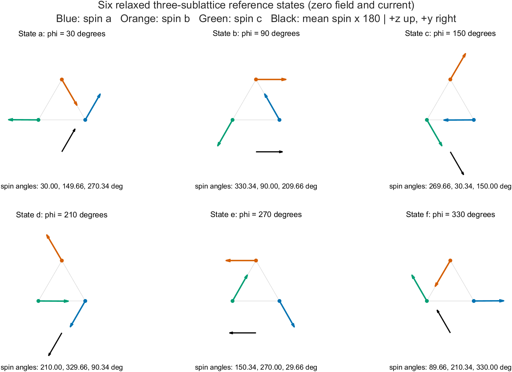
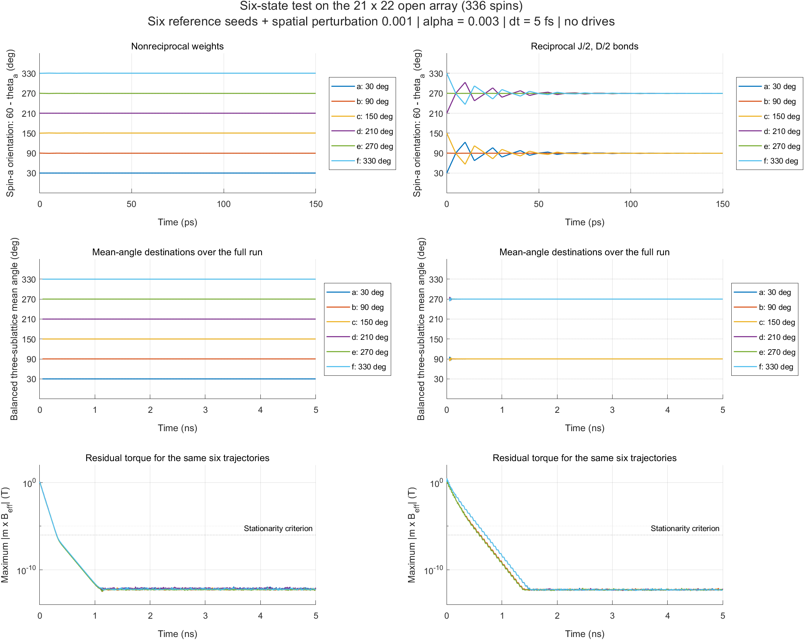
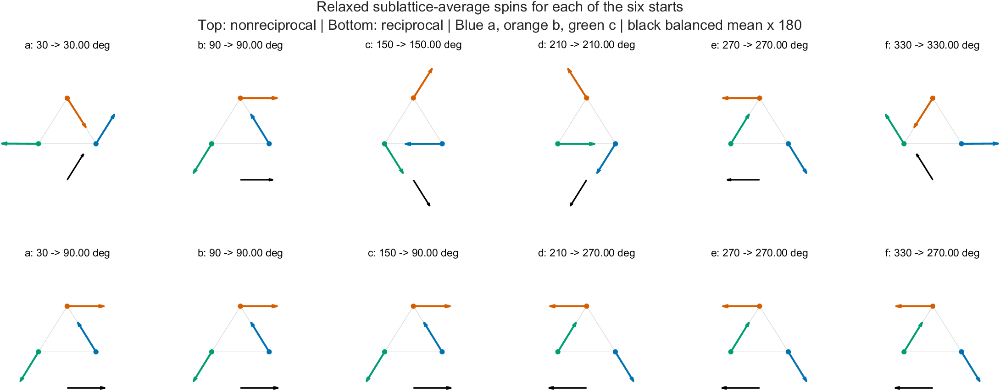

# Six-state relaxation: reference and spatial comparison

The six-state criterion changes the interpretation of the [earlier one-seed check](spatial-relaxation.md). **The nonreciprocal model retains all six reference orientations. The reciprocal J/2,D/2 model on the tested open patches retains only two destinations, 90° and 270°.** Both can reach small residual torque, but that alone does not demonstrate six equivalent states.

**Subsequent correction trial:** the reciprocal result here uses uniform onsite K. A [new trial with $K_i=Kz_i/4$](anisotropy-six-state.md) recovers all six stable, equal-energy states on the same graphs. This report preserves the uniform-K baseline; the new boundary-model assumption and its validation are documented separately.

## First: the six reference states

These are actual relaxed vectors from the three-spin control at zero field/current, using the native parameters already matched to PRB **109**, 134433 (2024). Angles run from +z toward +y in the spin-space yz plane. Site positions in the diagram are schematic. Blue, orange and green identify sublattices a, b and c; the black arrow is the small mean spin multiplied by 180 for visibility.



| State | Mean angle phi | Ideal theta_a | Ideal theta_b | Ideal theta_c |
|---|---:|---:|---:|---:|
| a | 30° | 30° | 150° | 270° |
| b | 90° | 330° | 90° | 210° |
| c | 150° | 270° | 30° | 150° |
| d | 210° | 210° | 330° | 90° |
| e | 270° | 150° | 270° | 30° |
| f | 330° | 90° | 210° | 330° |

The exactly ideal 120° seed has zero mean, whose angle is undefined. Relaxation introduces approximately 0.342878° canting in two of the three spins, producing the mean angle in the table. The figure prints the measured relaxed spin angles, not the ideal values. The six control angles agree with the targets within $1.03\times10^{-10}$ degree. Their energies are all approximately **−9.573769075686 meV per spin**, with a maximum spread of $3.56\times10^{-15}$ meV per spin.

The seed/angle mapping is the one already verified in `Mn3Sn_3atoms/FIG2_FIG4_SETTINGS.md`: $\theta_a=60^\circ-\varphi$ modulo 360°, followed by +120° and +240° for b and c. Easy-axis angles are 30°, 270°, 150° respectively. State labels a–f also agree with the [notebook transcription, page 15](Mn3Sn-notebook-transcription.md#page-15--configuration-ii-switching-table). This uses the existing reviewed paper evidence and reference-code correspondence, not a new extraction of the publication figure.

## Then: both spatial interaction choices

Each of the six ideal starts was run for 5 ns at 5 fs, both with and without a small spatially varying perturbation of amplitude $10^{-3}$ before normalization. All physical parameters, boundary masks and solver settings match the preceding investigation. Drives, thermal noise, dipoles and edge pinning are off. The panels below use the perturbed runs on the 21×22 open array, containing 336 spins.



The top row shows the first 150 ps using $60^\circ-\theta_a$ from the average a-sublattice spin. This texture coordinate is defined even when the initial mean moment vanishes. Canting and finite-edge deformation make it differ slightly from the mean-spin angle; it is labeled separately. The middle row shows the balanced mean-spin angle over 5 ns, omitting the first 0.05 ns and undefined moments below $10^{-10}$. The bottom row shows the residual torque over the full run. Saved samples are 5 ps apart; no smoothing is applied. Angle traces are unwrapped onto their corresponding initial branches.

The final spin configurations make the loss of distinct states explicit:



| Initial reference state | Nonreciprocal final angle | Reciprocal final angle |
|---|---:|---:|
| a: 30° | 30° | 90° |
| b: 90° | 90° | 90° |
| c: 150° | 150° | 90° |
| d: 210° | 210° | 270° |
| e: 270° | 270° | 270° |
| f: 330° | 330° | 270° |

The same pattern occurs at every tested size:

| Array | Sites in a,b,c | Total spins | Distinct nonreciprocal destinations | Distinct reciprocal destinations |
|---|---|---:|---:|---:|
| 5×5 | 5,6,5 | 16 | 6 | 2 |
| 5×6 | 6,8,6 | 20 | 6 | 2 |
| 9×10 | 20,23,20 | 63 | 6 | 2 |
| 13×14 | 42,46,42 | 130 | 6 | 2 |
| 21×22 | 110,116,110 | 336 | 6 | 2 |

Distinctness was checked using the **entire occupied-spin configuration**, with a maximum-component distance threshold of $10^{-6}$, not just rounded mean angles. Ideal and perturbed starts reach the corresponding same configurations within $2.84\times10^{-12}$ per component. This establishes the observed destinations for these starts and perturbations; it is not an exhaustive search for every possible nonuniform metastable texture.

## Why the finite reciprocal patch loses sixfold equivalence

These open patches contain more b sites than a or c sites. Write $N_a=N_c=N_0$ and $N_b=N_0+\Delta N$. For the ideal 120° texture parameterized by the table's state label $\varphi$, the actual onsite anisotropy sum gives

$$
E_{\rm ani}(\varphi)=-\frac32 K N_0-K\Delta N\sin^2\varphi.
$$

This follows directly from $-K\sum_i(\mathbf e_i\cdot\mathbf m_i)^2$, the source easy axes and the ideal spin angles above. The ideal texture has zero mean, so here $\varphi$ labels its orientation rather than the angle of a nonzero net moment. The formula was checked against direct site sums for all six array sizes and eight angles, with errors below $10^{-10}$ meV. Exchange and x-directed DMI are invariant under a common rotation of this ideal planar texture about x.

The extra term is explicitly **twofold** and favors 90° and 270°. For 21×22, $\Delta N=6$ and $K=0.196$ meV, so its total coefficient is −1.176 meV. It favors 90° over 30° by 0.882 meV total, or 0.002625 meV per spin, before canting/edge relaxation. Thus this finite patch does not preserve the bulk symmetry assumed by “six equivalent states.” The numerical trajectories and edge-deformed final states are consistent with that explicit symmetry breaking. This does not show that reciprocal exchange or DMI intrinsically destroys the bulk six-state structure.

The current nonreciprocal receiver weights instead make each site's summed exchange and signed DMI coupling to each other sublattice exactly match the triangle. This preserves its uniform three-sublattice dynamical subspace despite missing edge neighbors. The six orientations survive the tested spatial perturbations. However, the unequal reverse pair weights still prevent identifying those fields with the ordinary reciprocal pair Hamiltonian for equal physical Mn moments. **Six retained orientations do not resolve that physical inconsistency.** No spatial energy-degeneracy claim is made for the nonreciprocal case.

## Mean-angle convention on an unbalanced patch

For comparison with the three-spin reference, the plotted quantity is

$$
\mathbf m_{\rm bal}=\frac13\left(\overline{\mathbf m}_a+\overline{\mathbf m}_b+\overline{\mathbf m}_c\right),\qquad
\varphi_{\rm bal}=\operatorname{atan2}(m_{{\rm bal},y},m_{{\rm bal},z}).
$$

Each bar is the mean over sites of that sublattice. This differs from the physical whole-array mean $N^{-1}\sum_i\mathbf m_i$ when the sublattice populations differ. For example, the nonreciprocal 336-spin state a has balanced angle 30° but whole-array mean angle approximately 139.31°, because of the extra b moments. Both observables are retained in the saved data. The diagrams show the three sublattice averages without normalizing them; the black arrow shows the balanced mean. No claim of whole-array magnetization angles or AHE follows from relabeling these observables.

## Checks, artifacts and commands

The main dataset contains 126 trajectories: six triangle controls and 5 sizes × 2 interaction choices × 6 starts × 2 perturbation settings. Every case finishes below $8.05\times10^{-13}$ T maximum transverse field, with occupied norm error at most $2.23\times10^{-16}$. Six further 336-spin reciprocal trajectories at 2.5 fs over 2 ns preserve the destinations; the largest component discrepancy against 5 fs at common samples is $2.19\times10^{-7}$. This is below the existing $10^{-5}$ trajectory criterion. Prior actual MATLAB/GPU replay checks validate the unchanged compiled diagnostic; these full trajectories use that diagnostic, not full-length production GPU runs.

Scripts:

- [six_states.py](../verification/spatial_relaxation/six_states.py): generates the six seeds, runs the existing diagnostic, and saves sublattice observables.
- [check_six_states.py](../verification/spatial_relaxation/check_six_states.py): checks stationarity, reference degeneracy and distinct full-spin destinations.
- [plot_six_states.m](../verification/spatial_relaxation/plot_six_states.m): renders saved vectors and trajectories using MATLAB.

Local raw outputs are in `.sisyphus/six-state-20261102-01/`, including `six-state-summary.json`, `six-state-checks.json`, `refinement.json`, `boundary-anisotropy.json`, per-run binary/CSV files, and command/provenance manifests. They are ignored by Git. The operator inputs and replay gates are from `.sisyphus/spatial-relaxation-20261102-01/`; see the preceding report to recreate those first. To repeat the main sweep in a fresh directory:

```bash
python3 verification/spatial_relaxation/six_states.py .sisyphus/spatial-relaxation-20261102-01 .sisyphus/six-state-new reference
python3 verification/spatial_relaxation/six_states.py .sisyphus/spatial-relaxation-20261102-01 .sisyphus/six-state-new spatial
python3 verification/spatial_relaxation/check_six_states.py .sisyphus/six-state-new
matlab -batch "addpath('verification/spatial_relaxation'); plot_six_states('.sisyphus/six-state-new','docs','reference'); plot_six_states('.sisyphus/six-state-new','docs','comparison')"
```

The plotting command refreshes the three report PNGs; numerical results remain in the fresh directory. `analyze` can replace `reference`/`spatial` to regenerate observables without rerunning trajectories. The additional refinement repeats each of the six 21×22 reciprocal commands with 2.5 fs, 2000 ps total duration, 5 ps samples and the same initial file/0.001 perturbation. MATLAB R2024b Update 1 rendered the plots; each PNG was visually inspected. Python uses only the standard library.

Rendering limitation: the final MATLAB process printed both completion messages after exporting all three PNGs, then terminated during shutdown with `std::terminate()` and exit code 3. This is recorded in the local `plots.log`; its cause was not diagnosed. All three exported PNGs decoded successfully and were visually inspected, including the final six-panel comparison. The numerical runs and checks completed independently; no simulation was running in the plotting process. The plotting process is therefore not reported as a clean-exit check.

No production source, default, neighbor mask, parameter, or historical result was changed. Physical crystallographic mapping and periodic seams remain outside the verified scope. A future reciprocal model intended to retain six equivalent bulk states must address the finite geometry/termination as part of its specification; simply enlarging these particular open patches does not meet that requirement.
