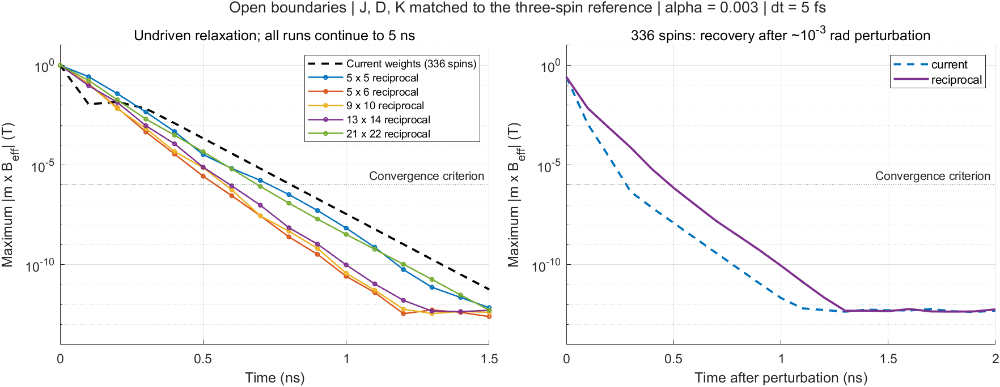

# Larger-array relaxation check

On 2026-11-02, both the current spatial weights and an isolated reciprocal-bond variant produced stationary, perturbation-resistant relaxation states on all tested open arrays, up to **336 occupied spins**. The default **10 ps runtime is too short** to reach equilibrium from the 121° seed. This check establishes numerical relaxation and local stability on the implemented graph; it does not establish its crystallographic correctness or a global ground state.

**Six-state follow-up:** the user clarified that correct relaxation must preserve the six equivalent PRB states. The [six-state comparison](six-state-relaxation.md) finds six retained orientations for current nonreciprocal weights, but only two destinations (90°/270°) for the reciprocal variant on these open patches. The one-seed stationarity result below therefore does **not** establish correct six-state relaxation for both models.



The figure uses saved samples every 100 ps, with no smoothing. The left panel displays the first 1.5 ns of 5 ns runs; the right panel displays the full 2 ns recovery test. The current-weight curves for all sizes overlap at this resolution. Numerical roundoff limits the late residuals.

## Models and normalization

Both tests use the existing occupation, neighbor graph, easy-axis assignments and directed DMI signs, open boundaries, fixed unit spins, and the coupled RK4 algorithm. There is no applied field, current, thermal noise, dipole field, or edge pinning. Parameters are the native three-spin reference values: $J/\mu=100.812$ T, $D=0.833$ meV, $K=0.196$ meV, $\mu=3\mu_B$, $\gamma=1.760859644\times10^{11}$ rad/(s T), and $\alpha=0.003$. The source seed has first-spin angle 121° with 120° sublattice offsets. Physical lattice coordinates remain unresolved.

- **Current weights:** execute the source fields unchanged. The receiver factor is 1 or 1/2. Unequal reverse weights occur on 12, 12, 28, 44 and 76 exchange pairs in the five larger arrays below. The normalized DMI matrix also fails antisymmetry by 1/2. Equal physical Mn moments therefore do not give the ordinary reciprocal pair Hamiltonian for these fields.
- **Reciprocal diagnostic:** keep the same graph and DMI directions, but use $J/2\approx8.75403$ meV and $D/2=0.4165$ meV on every existing bond. Keep $K$ and $\mu$ unchanged. Degree-four bulk sites have two neighbors of each other sublattice; two half-strength bonds reproduce one full-strength three-spin coupling. Open edges simply have fewer bonds. This is a mathematically equivalent bulk extension, not a newly established material-specific bond parameterization.

An additional source-operator check shows that **every site in the current-weight arrays has exactly the same summed exchange and signed DMI coupling to each other sublattice as the three-spin triangle**. Consequently, a spatially uniform three-sublattice state remains in the three-sublattice dynamical subspace. Reproducing its relaxation at larger size alone is insufficient to test spatial stability; the nonuniform perturbation checks below address that limitation.

For the reciprocal diagnostic, define $C_{ij}=\pm1/2$ by the source coefficient of $m_{jz}$ in $B_{iy}$, with $C_{ji}=-C_{ij}$. The tested energy is

$$
E=\sum_{i<j}\left[\frac J2\mathbf m_i\cdot\mathbf m_j-D C_{ij}\hat x\cdot(\mathbf m_i\times\mathbf m_j)\right]-K\sum_i(\mathbf e_i\cdot\mathbf m_i)^2.
$$

Only existing bonds enter the pair sum. The minus sign before DMI gives $B_{iy}^{\rm DMI}=(D/\mu)\sum_j C_{ij}m_{jz}$ and $B_{iz}^{\rm DMI}=-(D/\mu)\sum_j C_{ij}m_{jy}$ under $\mathbf B_i=-\partial E/\partial\mathbf m_i/\mu$. Finite differences checked this sign and normalization. The onsite field retains $2K/\mu$.

## Measured results

All primary runs last 5 ns at 5 fs per step. “Settled by” means the first 100 ps sample after which the maximum transverse field remains below $10^{-6}$ T through the end of the run; it is not a precisely located crossing time.

| Array slots | Occupied spins | Current weights: settled by | Reciprocal bonds: settled by | Final max transverse field, current / reciprocal (T) |
|---|---:|---:|---:|---:|
| 2×2 control | 3 | 0.9 ns | Not used as a spatial extension | $2.9\times10^{-13}$ / — |
| 5×5 | 16 | 0.9 ns | 0.8 ns | $2.8\times10^{-13}$ / $3.3\times10^{-13}$ |
| 5×6 | 20 | 0.9 ns | 0.6 ns | $6.3\times10^{-13}$ / $3.2\times10^{-13}$ |
| 9×10 | 63 | 0.9 ns | 0.6 ns | $4.7\times10^{-13}$ / $3.6\times10^{-13}$ |
| 13×14 | 130 | 0.9 ns | 0.6 ns | $5.0\times10^{-13}$ / $3.6\times10^{-13}$ |
| 21×22 | 336 | 0.9 ns | 0.7 ns | $5.8\times10^{-13}$ / $4.5\times10^{-13}$ |

Here the transverse field is $\max_i|\mathbf m_i\times\mathbf B_i|$, not the magnitude of the total exchange field. The maximum spin displacement during the final 100 ps is below $4.3\times10^{-14}$ in every case. Occupied norm errors are at most $2.23\times10^{-16}$; maximum preprojection norm error in the main runs is $7.74\times10^{-13}$.

The 10 ps checks at the native 0.5 fs step leave transverse fields of approximately **0.613 T** for current weights, **1.395 T** for the 16-spin reciprocal array, and **1.647 T** for the 336-spin reciprocal array. These are still relaxing, despite their normalized spins. For these initial conditions and sizes, a 2 ns relaxation window is sufficient for settling; 5 ns was used to verify persistence. Production defaults were not changed.

The reciprocal final states retain the noncollinear planar order but acquire finite-edge distortions: maximum angular deviations from their respective sublattice mean directions are approximately 1.10°, 0.99°, 1.49°, 1.76° and 2.06° for increasing size. These are maximum deviations anywhere, not bulk-average errors or a finite-size extrapolation. Final $|m_x|$ is below $1.3\times10^{-14}$ in the main runs.

## Stability and numerical checks

1. **Local perturbation recovery:** add $10^{-3}[\sin(1.7i),\cos(2.3i),\sin(0.9i)]$ to each settled occupied spin, then normalize, for occupied index $i=1,\ldots,N$. After 2 ns, all 11 cases return to their corresponding equilibria within $9.3\times10^{-13}$ per component. This perturbation excites both spatial nonuniformity and out-of-plane motion. It is a tested local stability result, not a proof for every perturbation direction.
2. **Perturbed startup:** repeat from the ideal seed with the same pattern at amplitude $10^{-2}$. Every case reaches a small-torque stationary state. The current-weight 3-spin and 16-spin cases select a different final orientation; other cases recover the original destination. Initial-basin sensitivity is distinct from instability of an already settled state.
3. **Timestep refinement:** 5 versus 2.5 fs over 1 ns gives a maximum sampled component difference of $3.37\times10^{-9}$ across all cases. Separate 10 ps comparisons at 5, 2.5 and 0.5 fs on 16 and 336 spins, both models, give 5 fs errors below $3.0\times10^{-8}$ relative to 0.5 fs. Halving the step reduces errors by factors 16.02–16.17, consistent with coupled RK4.
4. **Energy:** for the reciprocal model, energy per spin decreases to its final value, with the largest positive sampled increment only $1.64\times10^{-13}$ in $E/(N\mu)$ units (tesla), consistent with floating-point roundoff. The corresponding algebraic quantity for current weights is not the energy generating its fields and is not used as an energy-relaxation test.
5. **Source agreement:** measured linear operators reproduce random-state source fields within $2.85\times10^{-14}$ T. Reciprocal energy-gradient discrepancies are below $1.38\times10^{-8}$ T. Twenty-update trajectories from the actual MATLAB/GPU loop agree with the compiled diagnostic within $3.62\times10^{-16}$ per component over 24 fixtures: six sizes, two weight choices, and ideal/perturbed starts. Vacancies remain exactly zero, all saved states are finite, and the source time/update and occupied-norm checks pass.

Long runs use an isolated C++ diagnostic with the measured source operators and unchanged deterministic LLGS/RK4 equations. They are **not full-length GPU production runs**. The MATLAB/GPU fixtures validate that acceleration before its use. In total the investigation includes 56 longer diagnostic trajectories, plus the short replay fixtures. MATLAB R2024b Update 1 and NVIDIA GeForce RTX 3060 Laptop GPU were used; the replay was compiled with the installed `g++ -O3 -std=c++17`, without fast-math or new dependencies.

## Reproduction and artifacts

The tracked diagnostic code is in [verification/spatial_relaxation](../verification/spatial_relaxation/). Raw model matrices, source hashes, GPU trajectories, sampled spins, scalar traces and JSON checks for this run are locally retained in `.sisyphus/spatial-relaxation-20261102-01/` (ignored by Git). The key summaries are `summary.csv`, `summary.json`, `verified-gates.json`, `short-convergence.json` and `environment.json`. Binary trajectory records contain occupied spins in MATLAB column-major site order, interleaved x/y/z components, float64 little-endian, with one record per sample including both endpoints. `*-final.bin` contains only the last state. Times and residuals are in the corresponding CSV.

Run from the repository root with a **new** output directory:

```bash
mkdir -p .sisyphus/spatial-relaxation-new
matlab -batch "addpath('verification/spatial_relaxation'); prepare_spatial('.sisyphus/spatial-relaxation-new')"
python3 -c "import hashlib,json; from pathlib import Path; Path('.sisyphus/spatial-relaxation-new/source-hashes.json').write_text(json.dumps({p.name:hashlib.sha256(p.read_bytes()).hexdigest() for p in sorted(Path('.').glob('*.m'))},indent=2))"
python3 verification/spatial_relaxation/run.py .sisyphus/spatial-relaxation-new
matlab -batch "addpath('verification/spatial_relaxation'); plot_spatial('.sisyphus/spatial-relaxation-new','.sisyphus/spatial-relaxation-new/relaxation.png')"
```

Python uses only its standard library. The manifest command records the root MATLAB sources associated with the exported operators; run it immediately after preparation without changing those sources. The later anisotropy trial requires this `source-hashes.json`. `run.py` compiles the diagnostic, checks source replays and reciprocal energy derivatives, runs the size/refinement/perturbation cases, and checks the results. It refuses to overwrite an existing long-run dataset. `--check-only` rechecks existing outputs, reruns short compiled replays, and refreshes derived summaries without rerunning long trajectories. The final checked command was:

```bash
python3 verification/spatial_relaxation/run.py .sisyphus/spatial-relaxation-20261102-01 --check-only
```

The calculation sequence was executed during the investigation; the consolidated runner was subsequently checked against those saved outputs. The PNG was rendered by MATLAB and visually inspected. All root MATLAB sources remain byte-for-byte equal to their pre-task Git versions. Existing production MAT files were never selected as outputs. No production parameters, interactions, solver, or viewer snapshot changed.

## Interpretation and evidence boundary

The answer to the numerical question is **yes, for the tested sizes and conditions**. Equivalent bulk exchange and DMI couplings support stable relaxation on this graph. Current receiver scaling also settles, but the uniform three-sublattice trajectory masks its nonreciprocal spatial interactions. The reciprocal comparison is the more direct conservative-energy test and illustrates why free edges need not reproduce the three-spin angles exactly.

Neither result establishes a crystallographically validated spatial Mn3Sn model, periodic seam correctness, a global minimum, finite-temperature stability, domain-wall behavior, or behavior at arbitrary larger sizes. No lattice reconstruction or physical neighbor-shell assignment was introduced.

Publication basis: Zhengde Xu, Xue Zhang, Yixiao Qiao, Gengchiau Liang, Shuyuan Shi, Zhifeng Zhu, *Deterministic spin-orbit torque switching including the interplay between spin polarization and kagome plane in Mn3Sn*, Physical Review B **109**, 134433 (2024), [DOI](https://doi.org/10.1103/PhysRevB.109.134433). This investigation uses the already reviewed publication evidence and verified native three-spin parameters documented in [reference-protocols.md](reference-protocols.md), rather than re-reading the paper or making a new figure-reproduction claim.

Equation guidance consulted read-only: `presentations/equations/spintronic_methods.tex`, `sections/hamiltonian.tex`, `sections/llg_equation.tex` (`eq:ll-with-flt`) and `sections/atomistic_boundaries.tex`. These govern the energy/field derivative, explicit LLGS signs, and distinction between bulk normalization and open-edge coordination. The ASTRO README/AGENTS were consulted only for workflow scope; no material parameters or DMI geometry were transferred.
