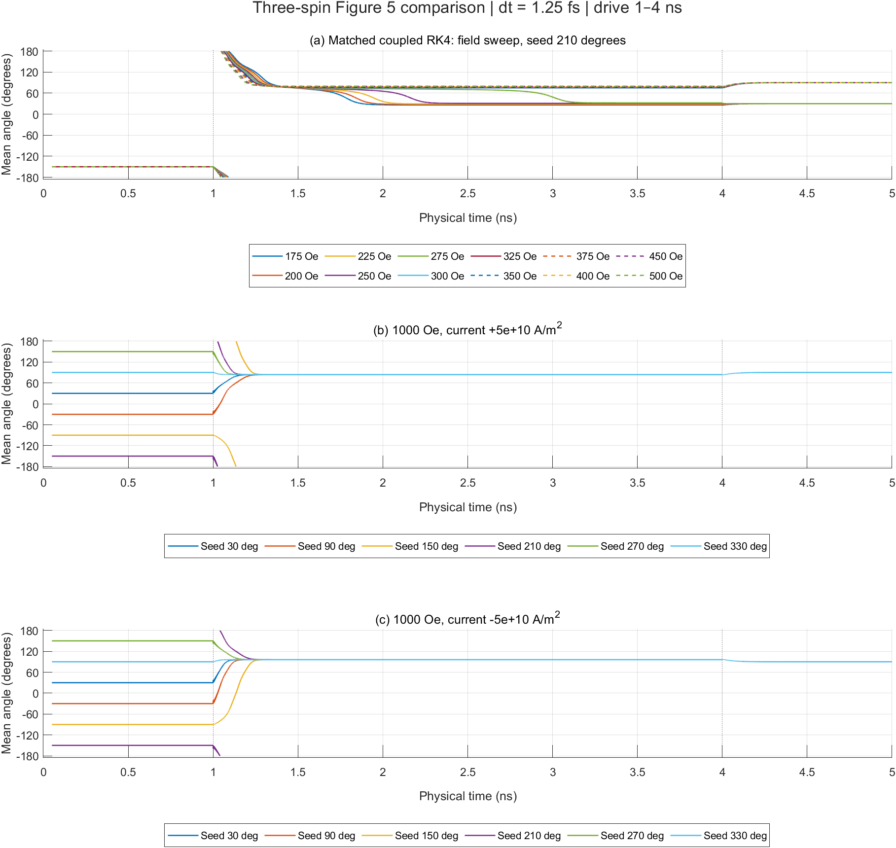
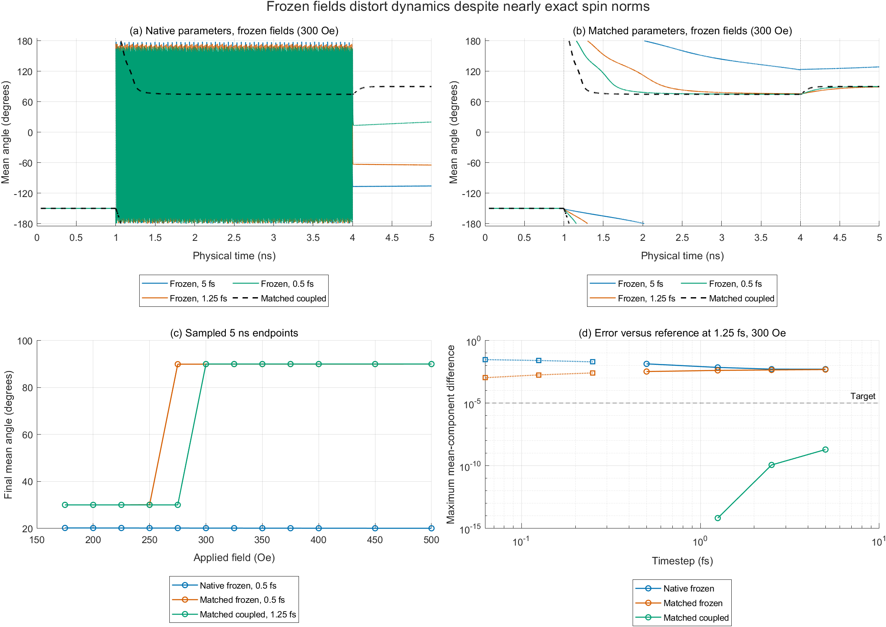

# Three-spin comparison — 2026-11-02

**The spatial code reduces to the reference triangle at the field/RHS level after explicit parameter matching. Recomputing fields at each RK stage also reproduces the corrected reference dynamics. The native frozen-field method does not meet the trajectory-accuracy target, including at its default 0.5 fs timestep.** No production MATLAB file, physical default, reference repository, or historical result was changed.

This executes the [approved comparison](../plan.md#three-spin-comparison--2026-11-02). The diagnostic is a Class 5, three-sublattice, fixed-length LLGS model. It establishes an algebraic three-vector correspondence, not the validity of the extended spatial lattice, periodic seams, or A02's larger-lattice weights.

## Mapping, fields, and parameters

Executing the original setup at `natomW=natomL=2`, `bc=1` gives occupation `[1 3; 1 1]`. Reference `(a,b,c)` maps to `((2,2),(1,1),(2,1))`, with easy-axis angles `(30,270,150)` degrees in the spin-space $yz$ plane. All three receiver factors become one. The three exchange pairs are reciprocal. With rows and columns ordered `(a,b,c)`, the measured exchange and DMI blocks are

$$
-\frac{\mu}{J}\frac{\partial B_{ix}}{\partial m_{jx}}
=\begin{pmatrix}0&1&1\\1&0&1\\1&1&0\end{pmatrix},
\qquad
\frac{\mu}{D}\frac{\partial B_{iy}}{\partial m_{jz}}
=\begin{pmatrix}0&-1&1\\1&0&-1\\-1&1&0\end{pmatrix}.
$$

The DMI $B_z$-from-$m_y$ block has the opposite sign. Directed DMI bond coefficients are antisymmetric; the complete Cartesian field Jacobian is symmetric, as required by the energy derivative for equal moments. The empty `(1,2)` entry is excluded from the three-vector state and remains zero when embedded in the array. Short native-kernel checks also exercise the post-kernel vacancy reset; normalization inside the legacy kernel still produces undefined values for a zero input before that reset.

The single-counted triangle energy is

$$
E=J\sum_{(i,j)=(a,b),(b,c),(c,a)}\mathbf m_i\cdot\mathbf m_j
+D\hat{\mathbf x}\cdot\sum_{(i,j)=(a,b),(b,c),(c,a)}\mathbf m_i\times\mathbf m_j
-\frac{K_f}{2}\sum_i(\mathbf e_i\cdot\mathbf m_i)^2
-\mu\sum_i\mathbf B_{\rm ext}\cdot\mathbf m_i.
$$

Here $\mathbf B_i=-\mu^{-1}\partial E/\partial\mathbf m_i$, and $K_f$ denotes the coefficient entering the field. Native `Ksim` equals $K_f$; matching the reference requires $K_f=2K$ for its energy coefficient $K=0.196$ meV. For cyclic `(i,j,k)`, the fields are $-(J/\mu)(\mathbf m_j+\mathbf m_k)$, $(D/\mu)\hat{\mathbf x}\times(\mathbf m_j-\mathbf m_k)$, and $(K_f/\mu)(\mathbf e_i\cdot\mathbf m_i)\mathbf e_i$. These expressions agree with the executed native stencils and `field_eta.m`; the published model source is [1, Sec. II]. Pair counting here is fixed by the reference implementation.

| Quantity | Native source | Matched/reference source |
|---|---:|---:|
| Moment $\mu$ (J/T) | $2.7822\times10^{-23}$ | same |
| Exchange $J/\mu$ (T) | 100.938106534397 | 100.812 |
| Exchange $J$ (meV) | 17.5299625468165 | 17.5080615730337 |
| Anisotropy $K_f/\mu$ (T) | 1.12857450938107 | 2.25714901876213 |
| DMI $D/\mu$ (T) | 4.79644166486953 | same |
| Gamma (rad/(s T)) | 175901203865.079 | 176085964400 |
| Damping | 0.003 | same |
| $M_s$ (A/m) | 73642.1386977237 | 441850 |
| Thickness (nm) | 0.4 | 30 |
| Damping-like SOT $b$ at $+5\times10^{10}$ A/m² (T) | 0.0335174244196183 | 0.0000744836428018559 |

The exact torque ratio is **449.997115591977**. The reference's rounded exchange field corresponds to 17.50806 meV rather than the nominal paper value 17.53 meV. Likewise, its `441850 A/m` differs slightly from evaluating $6\mu/V$ using the native constants. Equality checks retain the actual code values. Native/reference gamma differs by about 0.105%; anisotropy differs by a factor of two. No coefficient was tuned to obtain a destination.

Both implementations have the same explicit LLGS structure, including the Gilbert SOT cross term:

$$
\dot{\mathbf m}=\frac{\gamma}{1+\alpha^2}
\left[-\mathbf m\times\mathbf B-\alpha\mathbf m\times(\mathbf m\times\mathbf B)
-b\mathbf m\times(\mathbf m\times\hat{\mathbf x})+\alpha b\mathbf m\times\hat{\mathbf x}\right].
$$

The stored `hbar` is numerically $\hbar/e$ for the SI torque expression. There is no additional division by charge. Fields are tesla; the drive field is along $+y$, with `Oe × 1e-4` conversion. All thermal noise, STT, FLT, dipoles, wall initialization, pinning, distribution I/O, and inter-triplet coupling are disabled. The reference's second stored triplet is decoupled and does not enter the measured observable.

## Numerical gates

Stages ran in order: source setup/impulses, static fields and energy gradients, RHS/short replays, a full-length integration pilot, then the complete sweep. Independent read-only review checked the specification and harnesses. Numerical evidence comes from executed checks, not reviewer agreement.

| Check | Measured result |
|---|---:|
| Native stencils versus explicit triangle, all Cartesian impulses, both parameter sets | zero measured discrepancy |
| Reference `field_eta.m` versus separate exchange/DMI/anisotropy/Zeeman terms | maximum $2.84\times10^{-14}$ T |
| Scaled Cartesian finite-difference energy-gradient residual, eight deterministic random states, both parameter sets | maximum $2.23\times10^{-11}$; target $10^{-7}$ |
| Native first-stage RHS excerpt / `LLG_solver.m` versus explicit LLGS | relative error $2.15\times10^{-16}$ |
| Implicit Gilbert residual on unit spins | $3.50\times10^{-16}$ |
| Actual native kernel versus independent frozen-field RK4 step | $1.11\times10^{-16}$ |
| CPU versus GPU native scalar dispatch, including vacancy reset | zero measured occupied-spin discrepancy |
| Twelve 5 ps MATLAB/replay startup checks | maximum spin-component discrepancy $3.30\times10^{-14}$; target $10^{-10}$ |
| Eight 5 ps driven MATLAB/replay checks, restarted at 1.5 ns | maximum spin-component discrepancy $1.75\times10^{-13}$ |
| Full-sweep saved-state norm error | maximum $2.22\times10^{-16}$ |
| Full-sweep preprojection norm error, monitored every update | maximum $4.05\times10^{-13}$ |

The source checks use actual native kernel calls and the actual corrected `rk4_4llg.m` in isolated copies. The coupled diagnostic uses the independently measured field operators. RK intermediate states are not normalized; only completed steps are projected. Finite-difference perturbations are Cartesian and are not projected. Norm checks alone clearly fail to diagnose the frozen-field trajectory error below.

The driven checks cover all four variants at 300 Oe/positive current and 1000 Oe/negative current. Each restarted compiled segment first reproduced the corresponding full-trajectory samples with zero measured discrepancy. The additional native-kernel checks verify exact vacancy zeros after every short-run update. The GPU check exercises scalar dispatch/reset only; it is not a run of the full production integration script.

## Figure 5 results

There are **336 full 5 ns trajectories**: 24 physical cases, four variants, and 5/2.5/1.25 fs steps for every variant, plus 0.5 fs for both frozen-field variants. The four variants are native parameters/frozen fields, matched parameters/frozen fields, matched parameters/coupled RK4, and corrected reference/coupled RK4. The latter retains the reference's field-expression order and is independently checked against its MATLAB integration script.

All runs use reference first-spin seeds, overriding the spatial initializer's 121° seed. The other two spins are offset by 120°. Field/current drive updates over **[1,4) ns**, followed by relaxation to 5 ns. Samples occur every 0.25 ps, including initial and final states: 20,001 samples per run. Update counts are respectively 1,000,000, 2,000,000, 4,000,000, and 10,000,000 for 5, 2.5, 1.25, and 0.5 fs. This harness uses a physical clock and full final step; it does not reproduce either production script's legacy time-label/block bookkeeping. In particular, the reference script normally advances `N−1` times and its historical last sample is at 4.99975 ns.

For both coupled variants, every expected destination passes the 0.1° criterion at every tested step:

| Figure 5 case | Final signed mean angle |
|---|---:|
| Seed 210°, positive current; 175, 200, 225, 250, 275 Oe | 30° |
| Seed 210°, positive current; 300, 325, 350, 375, 400, 450, 500 Oe | 90° |
| 1000 Oe, six seeds, positive current | 90° |
| 1000 Oe, six seeds, negative current | 90° |

The sampled transition bracket is **275 < H ≤ 300 Oe** for this protocol. It is not a precisely determined critical field. At 4 ns the 1000 Oe driven angles are approximately **83.83110893°** and **96.16889107°** for positive and negative current; both relax to 90°. The largest final-angle error from the expected coupled destination is $6.62\times10^{-7}$ degree.

Across all 24 cases, matched coupled RK4 has maximum mean-component differences of **$2.13797\times10^{-9}$** for 5 versus 2.5 fs, and **$1.33636\times10^{-10}$** for 2.5 versus 1.25 fs. Their ratio is about 16, consistent with fourth-order convergence for this deterministic coupled system. The target is $10^{-5}$. Matched coupled versus reference at 1.25 fs has maximum mean-component difference $7.76\times10^{-12}$ over all sampled times.



## Frozen-field failure remains visible

Matching coefficients alone does not recover the reference trajectory. At the 0.5 fs native timestep, matched frozen fields pass 23 of 24 endpoint-angle checks, but **275 Oe ends at 89.9338° rather than 30°**. At 5, 2.5, and 1.25 fs, none of the 24 matched frozen endpoints meet the strict 0.1° criterion. Native parameters/frozen fields pass none of the 24 endpoint checks at any of those four timesteps; this comparison combines physical-parameter differences with numerical error, so it cannot attribute the native discrepancy to integration alone.

The 300 Oe pilot shows why a nearly correct endpoint is insufficient:

| Step (fs) | Native frozen final angle | Matched frozen final angle | Matched coupled final angle |
|---|---:|---:|---:|
| 5 | −105.8704° | 128.7627° | 89.99999934° |
| 2.5 | −39.6209° | 88.1520° | 89.99999934° |
| 1.25 | −64.6764° | 89.1727° | 89.99999934° |
| 0.5 | 20.1031° | 89.9507° | — |
| 0.25 | −94.2264° | 89.9970° | — |
| 0.125 | −150.5074° | 89.9998° | — |
| 0.0625 | −152.3085° | 90.0000° | — |

The six extra refinement runs are limited to this 300 Oe case; total full-length runs including them are **342**. Even at 0.0625 fs, the matched frozen trajectory differs from the 1.25 fs reference by **0.00108219** in a mean component and **0.314102** in a spin component. Halving the native frozen step from 0.125 to 0.0625 fs still changes a mean component by **0.00428947**. These trajectories remain outside the accuracy target; no fourth-order claim or converged native result follows. The reported values are finite-time endpoints, not independently certified equilibria.



The signed observable is `atan2d(mean_y,mean_z)`. The perfect 120° seed has undefined mean angle. Angle figures omit the first 0.05 ns and mask mean $yz$ magnitude below $10^{-10}$; plotted lines are broken at ±180° wraps. Numerical trajectory comparisons include all samples, including startup. Error comparisons use the maximum absolute component difference, not angular error near a compensated state. No smoothing or fitted experimental curves are used.

## Reproduce and inspect

Maintained harnesses: [runner](../verification/three_spin.py), [source/static checks](../verification/check_three_spin.m), [source/dynamics checks](../verification/check_three_spin_dynamics.m), [compiled replay](../verification/three_spin_replay.cpp), and [plotter](../verification/plot_three_spin.m).

The completed output directory is `.sisyphus/three-spin-20261102-02/` (about 528 MB). It contains source snapshots, `protected.json`, compiler provenance, `static.json`, `dynamics.json`, `driven.json`, `pilot.json`, `sweep.json`, `summary.csv`, `analysis.json`, `refinement.json`, logs, and binary trajectories. Each binary row is ten little-endian float64 values: seconds followed by `ax ay az bx by bz cx cy cz`. Each run's JSON records parameters, command, update count, endpoint, and norm errors. `run-manifest.json` records the diagnostic-source and binary-data SHA-256 hashes and repository revisions; an exact harness copy is retained in `harness/`. Raw outputs are ignored by Git; the figures and this report remain in `docs/`.

All 28 protected source/result paths passed the before/after hash or absence checks, including the reference's archived `result.txt`. Native base revision: `bc4a334c68aed09eb3bdd906719e51ca5642f6ab`; reference revision: `c141345441feacac73047ae8f811048b2494d824`. The user's existing `plan.md` additions were preserved and completed. Both PNGs were rendered and visually inspected; an independent read-only review also checked all 336 raw endpoints/4 ns states and selected full refinement traces against the report.

Use a **new** output-directory name when repeating the whole workflow. From the repository root, with the sibling `Mn3Sn_3atoms` checkout present:

```bash
python3 verification/three_spin.py prepare .sisyphus/three-spin-NEW
matlab -wait -batch "addpath('verification'); check_three_spin(fullfile(pwd,'.sisyphus','three-spin-NEW'))"
python3 verification/three_spin.py probes .sisyphus/three-spin-NEW
matlab -wait -batch "addpath('verification'); check_three_spin_dynamics(fullfile(pwd,'.sisyphus','three-spin-NEW'))"
python3 verification/three_spin.py pilot .sisyphus/three-spin-NEW
python3 verification/three_spin.py sweep .sisyphus/three-spin-NEW
python3 verification/three_spin.py analyze .sisyphus/three-spin-NEW
python3 verification/three_spin.py refine .sisyphus/three-spin-NEW
python3 verification/three_spin.py replays .sisyphus/three-spin-NEW
matlab -wait -batch "addpath('verification'); out=fullfile(pwd,'.sisyphus','three-spin-NEW'); check_three_spin_dynamics(out,'driven'); plot_three_spin(out)"
python3 verification/three_spin.py preserve .sisyphus/three-spin-NEW
```

The preparation stage refuses an existing directory. Later stages write their named diagnostic artifacts there. Compilation uses GCC 11.4.0 via `g++ -O3 -std=c++17 -Wall -Wextra -ffp-contract=off`; the runner uses Python 3.10.12 standard library only and up to four independent replay processes. MATLAB was **R2024b Update 1**, `24.2.0.2740171`, via the installed Windows launcher in WSL. The scalar GPU probe used an **NVIDIA GeForce RTX 3060 Laptop GPU**, compute capability 8.6. Full-length runs use the validated C++ replay on CPU; they are not full production MATLAB/GPU runs.

The first preparation attempt exposed Python 3.10's lack of `hashlib.file_digest`; the runner now uses streaming SHA-256. The first MATLAB launch hit the WSL sandbox interop restriction and was retried with approved escalation. An initial parameter parser missed indented `Dsim`; this harness-only issue was corrected before the passing static checks. These were execution/harness failures, not passing scientific gates. No dependency was installed and no network access was used.

## Evidence and limits

[1] Zhengde Xu, Xue Zhang, Yixiao Qiao, Gengchiau Liang, Shuyuan Shi, Zhifeng Zhu, Deterministic spin-orbit torque switching including the interplay between spin polarization and kagome plane in Mn3Sn, Physical Review B **109**, 134433 (2024). DOI: [10.1103/PhysRevB.109.134433](https://doi.org/10.1103/PhysRevB.109.134433).

Publication evidence is the already-reviewed record and PDF locators preserved in the approved plan: paper ID `AFM/2024-Deterministic spin-orbit torque switching including the interplay between spin-PRB-zhengde Xu`, Sec. II on printed page 134433-2 and Figure 5 on page 134433-5. The prior presentation record was `notes/ee237/week15a-afm/slides.md`; the paper supplies quantitative inputs. No source PDF or denied papers directory was reopened for this execution. Exact numerical comparison uses the current sibling repository's source and its `docs/rk4-verification.md`, not digitized published curves.

Equation files consulted under `presentations/equations/`: `spintronic_methods.tex`, `sections/hamiltonian.tex` (`eq:atomistic-effective-field`), and `sections/llg_equation.tex` (`eq:llg-gilbert`, `eq:ll-with-flt`). They fix the energy-gradient, flux-density, and Gilbert cross-term conventions. No ferrimagnetic geometry or material parameters were imported.

Physical lattice vectors, crystallographic site labels, stacking, finite-sample surfaces, and larger-lattice DMI mappings remain **REFERENCE MISSING** as recorded in the original audit. This algebraic triangle test does not resolve them. Noise, other solvers, other torque flags, domain walls, periodic topology, electronic structure, and Hall transport are outside this comparison. Long frozen trajectories may be sensitive to roundoff; short source agreement does not certify full-length bitwise equivalence. The coupled repair remains a diagnostic variant and requires separately approved production work.
